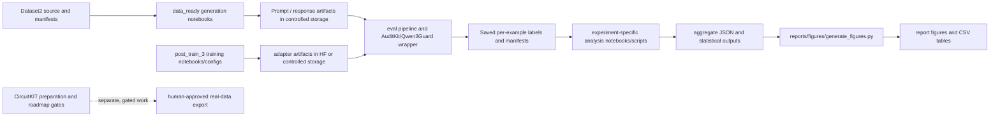

# Non-destructive repository reorganization plan

**Status:** implemented archival/navigation phase on 2026-11-16 with owner authorization. Historical reports, completed local run bundles and session notes move to the root `_archive/`; source/notebook imports and active experiment paths stay stable. See `_archive/MIGRATION_MANIFEST_20261116.json` for exact moves and pre-move hashes. The checkout contains substantial pre-existing modified and untracked work, including UK evaluation code and post-train-3 run artifacts; any future migration must preserve it and review ownership before changing paths. Current report artifacts live in `reports/`; experiment artifacts are not all in this checkout.

## Recommended public layout

Keep the existing top-level paths during the submission. They are already referenced by notebooks, Drive instructions, `README.md`, and the CircuitKIT roadmap. A later cleanup can add an index without immediately changing paths:

```text
README.md
reports/                         # canonical article, abstract, audit, source map
reports/figures/                 # generated PNG/SVG and figure script
reports/tables/                  # generated CSVs
docs/lexsi/                      # CircuitKIT roadmap, decisions, data gates
docs/REPOSITORY_REORGANIZATION_PLAN.md
data_ready/                      # Dataset2 and UK prompt-generation notebooks/helpers
eval/                             # Dataset2 and UK evaluation; track2_extension/CircuitKIT adapter
notebooks/                        # shared/source notebooks; classify before moving
post_train_3/                     # current JA arm, interim reports, aggregate result sources
scripts/                          # existing utilities; preserve import/CLI paths
tests/                            # source/test pairs
outputs/, runs/, evaluations/     # local/ignored run artifacts; archive/exclude selectively
```

Do not create duplicate `src/` copies of notebook code simply to make the tree look conventional. Extract shared modules only when notebook dependencies and outputs have been tested against the new import path.

## File-group migration inventory

| Current path or group | Proposed disposition/path | Why it matters and experiment dependencies | Public/release and storage guidance | Path-change risk |
|---|---|---|---|---|
| `reports/experiment_report.md`, `submission_abstract.md`, `CLAIM_AUDIT.md`, `EXPERIMENT_ARTIFACT_MAP.md`, `REPRODUCE.md`, `source_inventory.json` | **Stay** as canonical article package in `reports/` | Submission narrative, claim provenance, Drive inventory, reproducibility levels | Publish after final scientific review; Drive URLs must be labeled private/unverified when appropriate | Low; canonical links already use these paths |
| `reports/figures/generate_figures.py`, `reports/figures/*.{png,svg}`, `reports/tables/*.csv` | **Stay** in `reports/figures` and `reports/tables` | Generates and embeds the article’s six figure pairs from stored aggregates | Lightweight PNG/SVG/CSV/code suitable for GitHub; regenerate rather than edit plots manually | Low; relative Markdown links rely on current layout |
| `reports/20261105T134711Z/` | **Archived** under `_archive/reports/20261105T134711Z/`; script root detection and reproduction commands updated | Historical draft/version; establishes report provenance | Keep, do not delete; mark superseded in an index | Medium: old links may be referenced externally; no move until a reference scan |
| `post_train_3/reports/source_data/*.json` and README | **Stay**; add an index entry for Drive-only XSTEER B results | Machine-readable BI, steering, E1–E4, XSTEER A/D aggregates drive the report | Aggregate results are suitable for GitHub after provenance review; raw answers/prompt content require a safety/license review | Low; figure script consumes relative paths here |
| `post_train_3/reports/source_data/xsteer_b_*` | **External/Drive for now**, optionally add a small sanitized aggregate after validating its hash and schema | XSTEER B supports the all-layer, four-model diagnostic; report/RESULTS/JSON are currently Drive-only, 2.28 GB activations and 20.7 MB directions are omitted | Public release of summary only after artifact-hash and provenance checks; activations/directions need model/data and safety review | Low if only indexed; high if notebooks are moved or rerun paths change |
| `post_train_3/japan_culture/` | **Stay** as the explicit JA interim project namespace | Contains four-of-six interim analysis, outputs/status/notebooks, and work in progress | Publish only sanitized interim report/aggregates; raw prompts and responses need review | High: shared Drive and ongoing notebook paths encode this structure |
| `post_train_3/arm_ja/` | **Stay** as the arm-specific run archive; separate reusable code later only after final outputs | Adapter evaluation, logs, checkpoints, manifests and reproducibility packages | Do not upload raw harmful prompt/response files or large weights to GitHub by default; use reviewed HF/controlled storage | Very high: notebooks, checkpoints and Drive sync logic use these paths |
| `post_train_1/`, `post_train_2/` | **Keep as archival experiment namespaces** if restored from Drive; do not merge into BI or post_train_3 | Earlier diagnosis, SafeTune/CuratorKIT restricted-vs-broad pipeline; distinct cohorts and methods | Recover source notebooks/reports selectively; large or sensitive examples external after review | High: source-relative notebook dependencies likely; preserve original paths first |
| `data_ready/` | **Stay**; later index under docs rather than move | Dataset2 data construction and UK cultural-framing generation, with builder/helper code | Publish code and schemas; release generated prompts only after license/safety review; do not include private datasets | Medium/high: notebooks expect root-relative data paths |
| `eval/`, including `eval/track2_extension/` and UK evaluator | **Stay**; document boundaries between AuditKit scoring and CircuitKIT preparation | Existing Dataset2 analysis, HF/UK evaluation, AuditKit wrapper integration, CircuitKIT experiment-facing adapter | Code/tests may be public; raw SQLite/guard output and prompt content need review | High: import locations and embedded notebook helpers refer here |
| `notebooks/` | **Stay** initially; create a `notebooks/README.md` inventory before any moves, then classify into training/evaluation/analysis | Shared notebooks and notebook sources are part of experiment provenance | Keep lean source notebooks; exclude executed outputs with secrets, large outputs or raw risky text after preserving archival copies | Very high: relative input/output paths and Colab conventions |
| `scripts/`, root Python helpers (`guard_judge.py`, `local_server.py`, `evaluate_answercarefully.py`, `answercarefully_dataset.py`, `inspect_evaluation.py`, `review_results.py`) | **Stay** for now; possible future extraction to `src/` only with compatibility shims | Data loading, inference, scoring and review; article/toolkit attribution relies on these implementations | Source code suitable after secret scan; avoid publishing local paths or private results | High: root imports and CLI usage are established |
| `tests/`, `requirements.txt` | **Stay**; add per-component test instructions in a future docs pass | Validates UK evaluator and CircuitKIT integrations; dependencies reproduce tooling | Publish tests and pinned environment; avoid implying tests reproduce GPU or behavioral results | Low/medium |
| `docs/lexsi/` | **Stay** as CircuitKIT governance and roadmap | Contains approval, metric, data-quality gates and decisions. Current AGENTS instructions require roadmap upkeep | Public documentation can explain gates; private output paths and row-level audit data should remain excluded | Low; cited by evaluator and report |
| `outputs/`, `runs/`, `evaluations/`, `review_ui/`, `marcus/`, root `.sqlite3`, `eval_*jsonl` | **Archive or exclude selectively**, never bulk-delete | May contain source evaluation DBs, temporary review data, caches, or derived outputs; some are relevant to provenance | Maintain a private archive/index; inspect each database/file for raw prompts, personal data and ignored status before public release | High: some analysis scripts consume them directly; hash and dependency-check first |
| `requirements.txt`, `.gitignore`, `README.md`, `AGENTS.md`, `DATASET2_PLAN.md` | **Stay**; later cross-link to report/reproduction guides | Root usage, task governance and data planning; README is currently Dataset2-centered | Update README to point to multilingual report and explain experiment namespaces; never remove safety/approval instructions | Low if links only; avoid conflicting contributor instructions |

## Dependency map after any future restructuring



The CircuitKIT path is intentionally separate from the already completed behavioral experiments. Generated prompt/response records are untrusted input; an LLM review is provisional and cannot satisfy the human approval gate for exporting CircuitKIT execution inputs.

## Migration safety checklist

Before moving a file group:

1. Record current path, Git status, size, checksum, and Drive/HF counterpart.
2. Search notebooks, Python imports, Markdown, `.gitignore`, papermill parameters, Colab sync commands and CI for the old path.
3. Check whether the target file contains model outputs, secrets, personal data or harmful instructions; preserve a private copy before sanitization.
4. Move only source/config/docs first. Keep original experiment output folders immutable and retain their manifests.
5. Add compatibility links or path adapters for at least one transition period.
6. Run lightweight structural tests and figure validation. Do not rerun expensive inference solely to validate a path move.
7. Update `README.md`, `REPRODUCE.md`, the artifact map and any notebook launch instructions.

## Recommended order

1. Finish claim/source audits and publish sanitized report/aggregate bundle at current paths.
2. Add a repository inventory/index and mark source files, generated outputs, private data and archives without moving anything.
3. Recover the missing B5 computation and pending XSTEER C output; mirror non-sensitive source/configuration with checksums.
4. Split small reusable helpers into modules only after notebook dependency tests exist.
5. Archive or exclude generated/raw artifacts in targeted groups after confirming no analysis requires them.

**Implemented:** root archive and navigation indexes; no code-module or active-experiment relocation. Further module extraction remains a separate phase requiring dependency tests.


## Implemented validation

The migration manifest covers six moved bundles and 57 files. All destination hashes matched immediately after each move. Three historical reproduction files then received documented path repairs; their pre-edit and post-edit hashes are recorded. Root/source notebook defaults, active experiments, raw input defaults, `marcus/`, the virtual environment and CircuitKIT artifacts remain in place.

Validation completed:

- `python reports/validate_report.py`: six figure pairs and report checks pass.
- `.venv/bin/python -m unittest tests.test_guard_judge tests.test_dataset2_uk tests.test_uk_hf_evaluation`: 13 tests pass. The Controversial-label warning is expected by a fixture.
- Navigation links in eight entry points resolve; archived Python report scripts parse and locate the repository root.
- Private archived evaluation bundles match the new `.gitignore` exclusion.
- `pytest` was initially attempted but is not installed in the project environment; the suites were run using their native `unittest` runner instead.

No model inference or full historical-result revalidation was run. The old report's saved source-hash expectations describe its historical checkout and are not claimed to validate the current working tree. No commit or push was made.


## Follow-up: remove personal-name and UI directories from the root

The owner requested a stronger cleanup. `marcus/` moved to `data_ready/dataset2_snapshot/`; `review_ui/` moved to `eval/review_ui/`. Five files were hash-verified. Dataset CLI defaults, package source lists, notebook source paths, tests and current instructions now use the descriptive data location. The review server uses the new UI asset directory. Historical decision logs and archived snapshots retain their original path references as provenance. Colab embedded payloads are regenerated from the new source paths. See `_archive/MIGRATION_FOLLOWUP_20261116.json`.

### AnswerCarefully module relocation

The root AnswerCarefully dataset loader moved into `data_ready/`; evaluation, saved-output inspection and human review modules moved into `eval/`. Shell commands use `python -m` and the Colab upload cell recreates package subdirectories. The root audit and `_archive/MIGRATION_ANSWERCAREFULLY_20261116.json` record the details; no duplicate wrappers remain.
