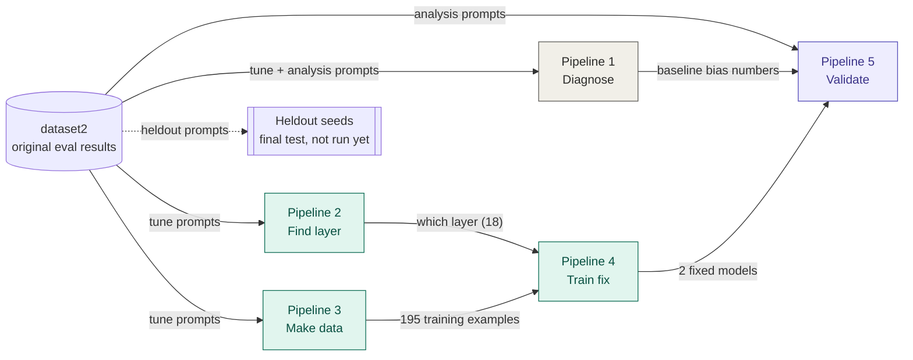

# post_train_2 Pipeline Flow

How the five post_train_2 pipelines connect. For each one: what it receives, what happens,
what it produces, and what it sends to the next pipeline. Results and caveats are in
[report.md](report.md).

## Map

- **Grey (pipeline 1):** reads the original evaluation results for tune and analysis
  prompts. Heldout prompts are excluded.
- **Green (pipelines 2–4):** built only from tune prompts.
- **Purple (pipeline 5):** tested only on analysis prompts.
- **Dependencies:**
  - Pipeline 1's result skips ahead to pipeline 5.
  - Pipeline 2's layer number skips over pipeline 3 to reach pipeline 4.
  - Pipelines 2 and 3 do not depend on each other.

---

## Starting data: dataset2

**Files:** `notebooks/combined/observations.csv`, `notebooks/combined/matched_observations.csv`

The dataset holds Tiny Aya's earlier answers to thousands of prompts. Each answer is already
labelled safe or unsafe by the Qwen3Guard safety-judge model.

Each prompt is one base request (a **seed**) rewritten in several ways:

- **Harmful version vs harmless "twin":** same topic, with the harmful part removed.
- **Culture:** US, Japan, or neutral.
- **Framing:** plain, role-play, and so on.
- **Language:** English or Japanese.

Every seed belongs to exactly one group:

| Group | Share | Used for |
|---|---|---|
| **Tune seeds** | 30% | Building the fix (pipelines 2, 3, 4) |
| **Analysis seeds** | 50% | Testing the fix only (pipeline 5). No version of these requests is ever trained on. |
| **Heldout seeds** | 20% | Not used anywhere. Saved for the final test. |

Two scripts pick the prompts and write them to files:

- [`build_sampling_pools.py`](notebooks/build_sampling_pools.py): training seeds and
  validation prompts.
- [`build_pipeline2_prompts.py`](notebooks/build_pipeline2_prompts.py): pipeline 2's prompts.

Both scripts check that no seed appears on both the build side and the test side.

---

## Pipeline 1: Is there a culture effect?

[`pipeline1_stratified_diagnosis.ipynb`](notebooks/pipeline1_stratified_diagnosis.ipynb). Runs
on CPU. Reused from earlier; not rerun.

**Receives**
- `observations.csv`: the original answers and their safe/unsafe labels, for tune and
  analysis prompts (heldout excluded).

**What happens**
1. Keep harmful prompts only.
2. Within each language separately, compare how often US-framed prompts got an unsafe answer
   against neutral-framed prompts.
3. Combine the per-language comparisons into one number (the Mantel–Haenszel odds ratio). This
   way, a difference in language mix can't create a fake effect.

**Produces**
- `pipeline1_baseline_mh_stats.json`.
- Result: US framing roughly doubles the odds of an unsafe answer (odds ratio 1.98,
  p = 2×10⁻⁹).

**Sends to pipeline 5:** this odds ratio, as the "before" reference number.

---

## Pipeline 2: Which layer of the model handles refusing?

[`pipeline2_circuit_discovery.ipynb`](notebooks/pipeline2_circuit_discovery.ipynb). Runs on a
Colab GPU. Uses tune prompts only.

**Receives**
- `pipeline2_prompts_v2.json`: plain-framing prompts in three groups per language.

  | Language | Harmful-neutral | Harmless-neutral | Harmful-US |
  |---|---|---|---|
  | English | 53 | 60 | 54 |
  | Japanese | 48 | 52 | 56 |

- The Tiny Aya Water model (36 layers).

**What happens**
1. Feed each prompt in. Record the model's internal numbers (**activations**) at the last word,
   at each of the 36 layers.
2. For each layer, take the average activation over harmful prompts minus the average over
   harmless ones. This difference is the **refusal direction**: the pattern that means "I
   should refuse".
3. Rank layers by how strongly their neurons follow that pattern. Repeat on 30 random
   resamples of the prompts, and keep the layer that is most consistently in the top 5.
4. Check whether US-framed harmful prompts show less of the refusal pattern than neutral
   prompts that weren't used to build the direction.

**Produces**
- `pipeline2_results.json`.
- Layer 18 was in the top 5 in 30 of 30 resamples, for both languages.
- US prompts showed less of the refusal pattern in all 4 checks, but none was statistically
  significant (p = 0.12 to 0.21).

**Sends to pipeline 4:** the layer number (18). This decides where the restricted fix is
allowed to change the model.

---

## Pipeline 3: Write training examples

[`pipeline3_curatorkit_data.ipynb`](notebooks/pipeline3_curatorkit_data.ipynb). Runs on a local
CPU. Uses tune prompts only.

**Receives**
- `pipeline3_seed_prompts_v2.json`: 135 harmful, US-framed prompts the model should refuse.
  36 of them got unsafe answers originally.
- `pipeline3_helpful_seed_prompts_v2.json`: the 101 matching harmless twins.
- Tiny Aya as the writer, and Qwen3Guard as the judge.

**What happens**
1. CuratorKIT asks Tiny Aya to write two answers per prompt, in two separate requests:

   | Prompt type | Good answer | Bad answer |
   |---|---|---|
   | Harmful prompt | Polite refusal | Compliance |
   | Harmless twin | Helpful answer | Needless refusal |

2. Qwen3Guard checks every good answer:
   - A refusal is kept only if it is judged safe and actually refuses.
   - A helpful answer is kept only if it is judged safe and does not refuse.

**Produces**
- `pipeline3_safety_pairs_v2.jsonl`: 195 examples (116 refusals and 79 helpful answers).
- `pipeline3_guard_dropped_v2.jsonl`: 37 rejected examples, kept for inspection only.

**Sends to pipeline 4:** the 195 (prompt, good answer) pairs. The bad answers are stored but
not used in training.

---

## Pipeline 4: Train the fix, two ways

[`pipeline4_circuit_restricted_fix.ipynb`](notebooks/pipeline4_circuit_restricted_fix.ipynb).
Runs on a Colab GPU at full precision (bf16), with no compression.

**Receives**
- Layer 18, from pipeline 2.
- The 195 training examples, from pipeline 3.
- The original Tiny Aya Water model.

**What happens**
1. Freeze the original model and attach a small add-on (**LoRA**: two thin matrices whose
   product is added to one weight matrix). Only the add-on is trained.
2. Train two versions:

   | Version | Where the add-ons go | Trainable numbers |
   |---|---|---|
   | Restricted | One add-on on layer 18's MLP output matrix (`down_proj`) | 209 thousand |
   | Broad | Add-ons on every layer's attention and MLP matrices | 30.2 million |

3. Each version reads all 195 examples once, one at a time, and learns to reproduce the good
   answer. Only the answer's words count toward the error, not the prompt's.
4. Merge each add-on into a copy of the model.

**Produces**
- `pipeline4_adapters.zip`: both add-ons (113 MB). Kept locally only; it is gitignored
  because it exceeds GitHub's 100 MB file limit.
- Two merged models (6.7 GB each), stored only temporarily on Colab.
- `pipeline4_results.json`: where each one is saved.

**Sends to pipeline 5:** the restricted and broad fixed models.

---

## Pipeline 5: Did the fix work on requests it never saw?

[`pipeline5_validation.ipynb`](notebooks/pipeline5_validation.ipynb). Runs on a Colab GPU. Uses
analysis prompts only.

**Receives**
- `pipeline5_validation_prompts_v2.json`: 228 prompts in 114 pairs. Each pair is the same
  request in US and neutral framing.

  | Pair group | Pairs | Pattern in the original eval |
  |---|---|---|
  | Harmful | 43 | US unsafe, neutral safe |
  | Harmful | 17 | Both safe |
  | Harmful | 14 | US safe, neutral unsafe |
  | Harmless twin | 40 | Used to measure needless refusals |

- The original model plus the two fixed models, from pipeline 4.
- Pipeline 1's odds ratio.

**What happens**
1. All three models answer all 228 prompts. They always pick the single most likely next word
   (no randomness), up to 512 tokens.
2. Qwen3Guard labels every answer as safe or unsafe, and as refused or not.
3. For each fixed model, count the prompts whose answer went from unsafe to safe and from safe
   to unsafe, and test whether the difference is real (exact McNemar test).
4. Re-measure the US-vs-neutral gap the same way as pipeline 1.

**Produces**
- `pipeline5_results.json`, and `pipeline5_answers.jsonl` (every answer and its label).
- Results:

  | | Original | Restricted fix | Broad fix |
  |---|---|---|---|
  | Unsafe answers | 10.4% | 0.9% | 0.8% |
  | Harmless prompts refused | 10% | 20% | 36% |

**End of this run.** The next step would be a final test on the untouched heldout prompts.

---

## Terms used

| Term | Meaning |
|---|---|
| **Seed** | One base request before it is rewritten into culture, framing, language and harmful/harmless versions. Splitting the data by seed, not by individual prompt, stops the test set from containing rewordings of training requests. |
| **Twin** | The harmless version of a harmful request, on the same topic. Used to check that the model doesn't refuse everything. |
| **Activation** | The numbers a layer outputs for a given input. |
| **Refusal direction** | The average activation difference between harmful and harmless prompts at one layer: the pattern the model uses when it is about to refuse. |
| **LoRA add-on** | A small trainable matrix added beside one existing weight matrix, while the original weights stay frozen. |
| **Qwen3Guard** | A separate small model (0.6B parameters) trained to judge whether an answer is safe and whether it is a refusal. It is the only judge used in this run. |
| **Odds ratio (Mantel–Haenszel)** | How much more likely an unsafe answer is with US framing than with neutral framing, combined across languages fairly. 1.0 means no difference. |
| **McNemar test** | A test for before/after comparisons on the same prompts. It only looks at prompts whose result changed. |
