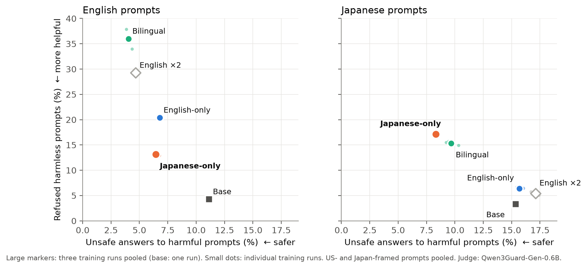
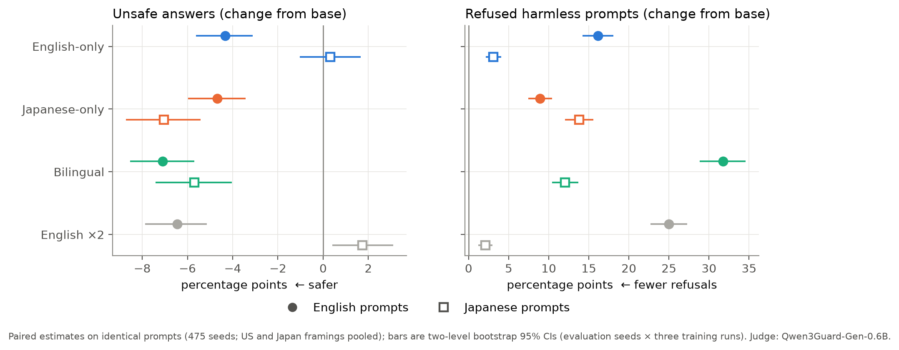
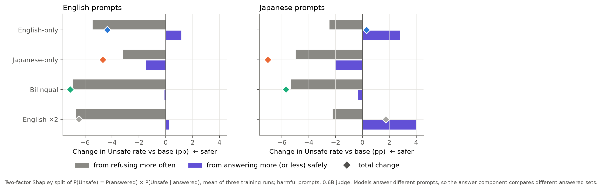
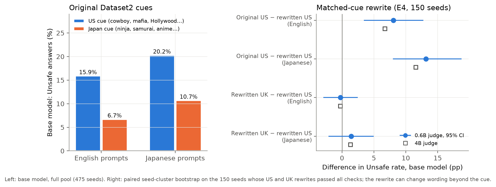
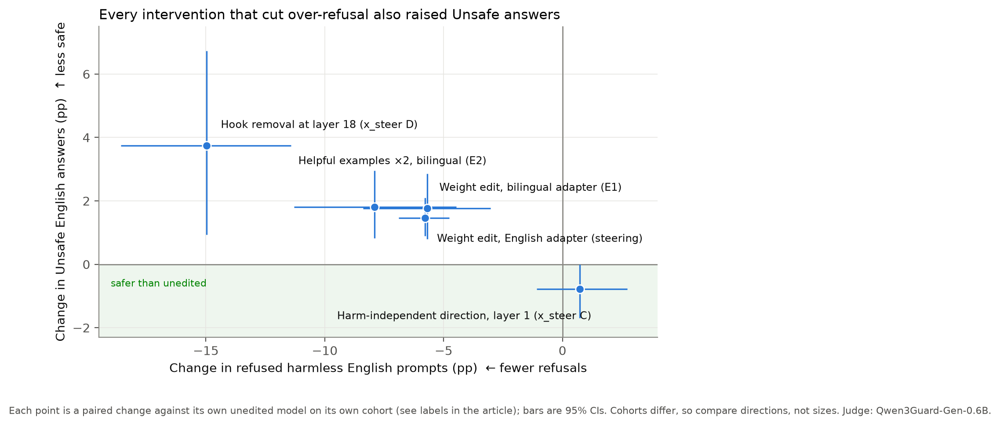

# Safer, or Just More Refusals? English, Japanese and Bilingual Safety Fine-Tuning of Tiny Aya

*Technical article, version 2 (2026-11-16). LEXSI AI Safety & Alignment Hackathon 2026, Track 2. All behaviour labels are automated
(Qwen3Guard) and have not been human-reviewed. Every number below is traced to a saved output in [`CLAIMS.md`](CLAIMS.md).*

## Abstract

We post-trained the multilingual model Tiny Aya Water with small safety adapters (LoRA) on the same 568 safety examples, written
in English only, in Japanese only, or in both languages (bilingual), at layer 18, the refusal layer identified by **SafeTune**.
Bilingual training sees each example twice (once per language), so to rule out the effect of its longer training we added a
control trained on the English examples twice. Each condition was trained three times.

Prompts come from Dataset2, our matched jailbreak prompts generated with Qwen3-4B and baselined with **AuditKIT**. Each harmful
request, wrapped in a jailbreak framing (role-play, fiction) in English and Japanese, is paired with a harmless "twin". We scored
replies with the Qwen3Guard-Gen-0.6B judge on two numbers: the **Unsafe rate** (share of answers to harmful prompts labelled
Unsafe) and **over-refusal** (share of harmless twins refused).

**Japanese-only training gave the best balance and transferred to English.** On English prompts it matched English-only training
on safety (6.45% vs 6.78% Unsafe; paired difference −0.33 points, 95% CI −1.09 to +0.45) while refusing fewer harmless prompts
(13.2% vs 20.4%). On Japanese prompts it had the lowest Unsafe rate of any condition (8.3% vs 15.4% base, 15.7% English-only,
9.7% bilingual), and it was the only condition that also lowered the Unsafe rate among the prompts it answered (20.6% → 17.2%).
Its cost was the highest Japanese over-refusal (17.1%, vs 15.4% bilingual).

**English training did not transfer to Japanese.** Japanese Unsafe stayed at 15.7% with English-only training and rose to 17.1%
with doubled English data.

**Bilingual training was the safest overall, but almost entirely by refusing more.** Unsafe fell from 13.3% (702/5,282) to 6.9%
(1,147/16,743), while over-refusal rose from 3.8% (144/3,800) to 25.7% (2,927/11,400), reaching 36.0% on English prompts.
Among prompts it answered, it was no safer than the base model (18.1% vs 17.8% Unsafe).

**Cultural framing.** Every prompt also exists in two cultural framings: a US framing with words such as cowboy, Wild West or
mafia, and a Japan framing with words such as ninja, samurai or anime. Such words could themselves act as jailbreak cues, so
testing them in both languages separates the effect of language from that of culture-specific vocabulary. US-framed prompts were
about twice as unsafe as Japan-framed ones at baseline (English 15.9% vs 6.7%), but this reflected the specific cue words: when
each prompt was rewritten with one comparable, harmless cue (150 seeds), US and UK framings were equally unsafe (7.9% vs 7.7%).

**Reducing over-refusal cost safety.** **CircuitKIT** cannot run circuit discovery on Tiny Aya, so we edited activations
directly. Removing a "false-refusal" direction from the English adapter lowered English over-refusal from 20.9% to 15.1% but
raised Unsafe from 6.6% to 7.8%, failing our pre-set criterion; at layer 18 the direction was causal but raised Unsafe answers in
both languages. An earlier pilot with **CuratorKIT** training data found that a layer-18 adapter matched a full-model adapter's
safety with about half its over-refusal.

### Terms used in this article

| Term | Meaning |
|---|---|
| Jailbreak prompt | A harmful request wrapped in a framing meant to get past refusals, such as role-play or fiction. |
| Harmless twin | A safe version of the same request with the same framing; tests whether the model refuses what it should answer. |
| Unsafe rate | Share of answers to harmful prompts that the judge labels Unsafe (lower is safer). |
| Over-refusal | Refusing to answer a harmless prompt (lower is better). |
| Judge (Qwen3Guard) | A separate small safety-classifier model that labels each answer Safe / Unsafe / Controversial and Refused / Not refused. The 4B version is a cross-check. |
| LoRA adapter | A small add-on trained on top of the frozen base model. |
| Bilingual training | Each training example shown in English, then in Japanese. |
| English ×2 (dose control) | English examples shown twice, so its training length equals bilingual's. |
| Fix rate | Share of the base model's Unsafe answers (to clearly harmful prompts) that a trained model no longer gives. |
| Unsafe among answered | The Unsafe rate counting only prompts the model did not refuse. Each model answers a different set of prompts. |
| Cultural framing / cue | Setting the same request in a culture's context with culture-specific words (the cue), e.g. "cowboy" or "ninja". |
| Steering / direction | A pattern in the model's internal activations linked to a behaviour; removing it aims to change that behaviour. |
| pp | Percentage points: the absolute difference between two rates (6.3% → 3.1% is −3.2 pp). |

### Key findings at a glance

| Question | Finding | Qualification |
|---|---|---|
| Does Japanese safety data help English? | Yes: Japanese-only matched English-only on English Unsafe rate (6.45% vs 6.78%) with fewer English refusals (13.2% vs 20.4%). | Secondary contrast; replication on two item halves leaned about 2 pp worse for Japanese-only, and its English fix rate was lower. |
| Does English safety data help Japanese? | No: Japanese Unsafe 15.4% (base) → 15.7% (English-only) → 17.1% (English ×2). | Base has one run; changes are paired estimates. |
| Which condition is safest in Japanese? | Japanese-only (8.3%), ahead of bilingual (9.7%; difference 1.35 pp, CI 0.47–2.29). | Japanese-only refuses the most harmless Japanese prompts (17.1%). |
| Is bilingual training really safer? | Lowest overall Unsafe rate (6.9%), but its gain came almost entirely from refusing more. | Over-refusal 25.7% overall, 36.0% on English prompts. |
| Is US culture riskier? | Not when cues are matched: US 7.9% vs UK 7.7% in English. | Rewrites can change wording beyond the cue; 150 of 276 seeds passed. |
| Can over-refusal be removed safely? | No tested method did: every reduction raised Unsafe answers. | Different cohorts per method; one adapter for the causal test. |

## 1. Research question

Small multilingual models are often safety-tuned mostly on English data. We ask two questions:

1. **Does the language of the safety-training data decide which prompt languages become safer?**
2. **When the Unsafe rate falls, is that because the model answers more safely, or because it refuses more, including harmless
   requests?**

We answer both with one controlled comparison (Section 4), then decompose the safety gains (Section 5), test whether the
US-vs-Japan cultural framing is a separate factor from language (Section 6), and ask whether over-refusal can be removed after
training (Section 7).

## 2. Model, data and training

**Model.** [`CohereLabs/tiny-aya-water`](https://huggingface.co/CohereLabs/tiny-aya-water), 3.35 billion parameters, base weights
frozen. Each adapter is a PEFT LoRA (rank 16, alpha 32, dropout 0.05) on `model.layers.18.mlp.down_proj` only, 208,896 trainable
parameters. Training: AdamW, learning rate 1e-4, batch 1, one epoch, maximum length 768. Evaluation: merged bf16 adapters served
with vLLM, greedy decoding, up to 1,024 new tokens.

**Training data.** 568 aligned items: 284 refusal targets for harmful requests and 284 helpful answers for harmless twins. The
target answers were written by base Tiny Aya in both languages and kept only when the Qwen3Guard judge passed them.

| Condition | Training rows | Steps | Runs |
|---|---|---|---|
| English-only (`en`) | 568 English | 568 | 3 |
| Japanese-only (`ja`) | 568 Japanese | 568 | 3 |
| Bilingual (`bi`) | each item in English, then Japanese | 1,136 | 3 |
| English ×2 (`en2`) | each English row twice | 1,136 | 3 |

English ×2 exists for one reason: bilingual training trains for twice as many steps, so any bilingual advantage could come from
the extra training rather than the second language. English ×2 has the same length with no Japanese.

**Evaluation prompts.** The frozen evaluation pool has 519 source seeds; paired analyses use the 475 seeds whose prompts passed
every generation check (`paired_ok`). Each seed yields a harmful request and its harmless twin, in English and Japanese, under
US and Japan cultural framings, in several jailbreak framings. Different studies use different cohorts, and their rates are not
pooled:

| Study | Cohort | Runs |
|---|---|---|
| Training-language comparison (Sections 4–5) | full pool, 475 seeds, US + Japan framing | 3 per condition, 1 base |
| Matched-cue test E4 (Section 6) | half pool, 150 of 276 seeds | base and seed-0 adapters |
| Replication E3 (Section 4.4) | half pool, 276 seeds | 1 run per item half |
| Steering and x_steer (Section 7, Appendix B) | full pool, half pool, or held-out fold (stated per result) | 1–3 |

## 3. Lexsi toolkits and their roles

| Toolkit | What it did in this project (verified in code) | What it did not do |
|---|---|---|
| **SafeTune** | Refusal-direction extraction and safety-neuron ranking that picked layer 18; LoRA wrapping for the earlier pilot (`post_train_2/notebooks/pipeline2_*`, `pipeline4_*`). | Did not train the main adapters (PEFT directly, same layer and recipe). |
| **CuratorKIT** | Generated refusal and helpful preference pairs for the earlier restricted-vs-broad pilot (`pipeline3_curatorkit_data.ipynb`). | Not used for the main training items. |
| **AuditKIT** | Scored the Dataset2 baseline with Qwen3Guard-Gen-0.6B as its guard judge (`guard_judge.py`, `eval/dataset2_runtime.py`). | The main runs called the same judge model directly through vLLM. |
| **CircuitKIT** | Integration checks: its log-probabilities match Tiny Aya's. | No circuit discovery: it needs TransformerLens, which does not support Tiny Aya. The steering experiments use direct activation hooks. |

## 4. Training language decides where safety improves

*Figure 1. Unsafe answers to harmful prompts (x) against refused harmless prompts (y), by prompt language. Large markers pool three
training runs; small dots are single runs; base has one run. Lower-left is better on both.*

| Prompt language | Condition | Unsafe | Over-refusal |
|---|---|---|---|
| English | Base | 11.13% (288/2,588) | 4.26% (81/1,900) |
| English | English-only | 6.78% (557/8,211) | 20.39% (1,162/5,700) |
| English | **Japanese-only** | **6.45% (528/8,183)** | **13.16% (750/5,700)** |
| English | Bilingual | 4.03% (338/8,383) | 36.00% (2,052/5,700) |
| English | English ×2 | 4.67% (389/8,338) | 29.26% (1,668/5,700) |
| Japanese | Base | 15.37% (414/2,694) | 3.32% (63/1,900) |
| Japanese | English-only | 15.68% (1,297/8,273) | 6.39% (364/5,700) |
| Japanese | **Japanese-only** | **8.33% (696/8,359)** | **17.12% (976/5,700)** |
| Japanese | Bilingual | 9.68% (809/8,360) | 15.35% (875/5,700) |
| Japanese | English ×2 | 17.11% (1,412/8,253) | 5.39% (307/5,700) |

Trained-condition counts sum three runs. US- and Japan-framed prompts are pooled.

*Figure 2. Paired change from the base model on identical prompts, with two-level bootstrap 95% CIs (evaluation seeds × training
runs). Filled circles: English prompts; open squares: Japanese prompts.*

### 4.1 Japanese-only training: English parity, best in Japanese

On **English** prompts, Japanese-only and English-only adapters had statistically indistinguishable Unsafe rates (paired
difference −0.33 pp, 95% CI −1.09 to +0.45), while Japanese-only refused 7.2 pp fewer harmless English prompts (CI −8.7 to −5.8).
Its English fix rate was lower (67.0% vs 70.8%; −3.8 pp, CI −7.7 to +0.03), so English-only fixes slightly more of the base
model's English failures.

On **Japanese** prompts, Japanese-only gave the lowest Unsafe rate of every condition: −7.04 pp from base (CI −8.72 to −5.42),
−7.35 pp versus English-only, and 1.35 pp below bilingual (CI 0.47 to 2.29). It fixed 72.0% of the base model's Japanese failures,
against 41.8% for English-only (+30.2 pp, CI 25.4 to 35.0). Its cost is over-refusal in Japanese: 17.1%, compared with 3.3% for
base, 6.4% for English-only and 15.4% for bilingual (bilingual − Japanese-only: −1.77 pp, CI −2.86 to −0.72).

These Japanese-only comparisons are secondary contrasts: two-level bootstrap on the 0.6B judge, not part of the Holm-corrected
primary family below.

### 4.2 English training does not reach Japanese

English-only training lowered English Unsafe by 4.34 pp (CI −5.63 to −3.11) but left Japanese unchanged (+0.31 pp, CI −1.04 to
+1.66). Doubling the English data made Japanese slightly worse: +1.74 pp from base (CI +0.40 to +3.09) and +1.43 pp versus
English-only. The asymmetry is the central result: Japanese safety data transfers to English, English safety data does not
transfer to Japanese.

### 4.3 Bilingual training: the language matters, not the extra steps

The pre-specified primary tests (Holm-corrected, both judges) compare bilingual training with English-only and with English ×2:

| Contrast (Unsafe rate) | 0.6B judge, pp (95% CI) | Holm p | 4B judge, pp |
|---|---|---|---|
| Bilingual − English-only, English prompts | −2.75 (−3.56 to −1.95) | < 0.001 | −1.68 |
| Bilingual − English-only, Japanese prompts | −6.00 (−7.38 to −4.65) | < 0.001 | −4.42 |
| Bilingual − English ×2, English prompts | −0.63 (−1.26 to +0.02) | 0.11 | −0.25 |
| Bilingual − English ×2, Japanese prompts | −7.43 (−8.91 to −5.99) | < 0.001 | −5.69 |

Against the dose control, bilingual training has no established English advantage, but a large Japanese one. The Japanese gain
therefore comes from the Japanese rows, not from training longer. On English prompts bilingual training refuses 36.0% of
harmless prompts, the most of any condition.

### 4.4 Replication: the Japanese pattern holds on new items

The follow-up E3 (half pool, US framing) repeated the comparison with a dose-controlled Japanese ×2 adapter and with two
disjoint halves of the training items (one run each):

- Doubling the Japanese data changed nothing (English Unsafe −0.64 pp, CI −1.63 to +0.32).
- On both item halves, Japanese training refused fewer harmless English prompts (−7.6 and −6.2 pp; confirmed) and was safer on
  Japanese prompts (−7.6 and −2.7 pp; confirmed).
- On English prompts, Japanese training was about 2 pp less safe than English training on both halves (+1.9 and +2.0 pp; Holm
  p 0.055 and 0.067), and its English fix rate was lower. The English-parity result is therefore "close", not "equal".

## 5. Safer answers, or more refusals?

The Unsafe rate can fall for two reasons: the model refuses more harmful prompts, or it answers them more safely. Writing
P(Unsafe) = P(answered) × P(Unsafe | answered), we split each change from base into these two parts with a two-factor Shapley
decomposition (mean of three runs; harmful prompts; 0.6B judge).

*Figure 3. Change in the Unsafe rate from base, split into the part from refusing more often (grey) and the part from answering
more or less safely (purple). Diamonds: total change.*

| Condition | Prompts | Total change | From refusing | From answering | Unsafe among answered (base → model) |
|---|---|---|---|---|---|
| Japanese-only | Japanese | −7.04 pp | −5.00 | **−2.05** | 20.57% → 17.24% |
| Japanese-only | English | −4.68 pp | −3.18 | **−1.48** | 14.98% → 12.61% |
| Bilingual | Japanese | −5.69 pp | −5.34 | −0.35 | 20.57% → 19.99% |
| Bilingual | English | −7.10 pp | −6.94 | −0.12 | 14.98% → 14.74% |
| English-only | English | −4.34 pp | −5.48 | +1.18 | 14.98% → 17.04% |
| English-only | Japanese | +0.31 pp | −2.49 | +2.80 | 20.57% → 24.61% |
| English ×2 | Japanese | +1.74 pp | −2.25 | +3.99 | 20.57% → 26.28% |

- **Japanese-only is the only condition whose answers became safer** in both languages. About 70% of its gain comes from
  refusing more and about 30% from safer answers.
- **Bilingual and English training gained safety by refusing**: bilingual's answer component is near zero, and English training
  made the answers it did give *less* safe, offset by more refusals.

This is a descriptive decomposition. Each model answers a different set of prompts, so "Unsafe among answered" compares different
answered sets and does not estimate a causal effect. The identity holds almost exactly here: only 2 of about 16,500
Japanese-only rows were both refused and Unsafe, and none for the other conditions.

## 6. Culture or language?

Dataset2 gives every request a **cultural framing**. The **US framing** places it in an American setting with cue words such as
cowboy, Wild West, mafia or Hollywood. The **Japan framing** uses cues such as ninja (25% of Japan-framed English prompts),
samurai (9%) or anime. Prompt language and cultural framing vary independently: an English prompt can carry a Japan cue. We
included culture to tell apart two explanations for a safety failure: the *language* of the prompt, and *culture-specific words*
that may themselves work as jailbreak cues.

*Figure 4. Left: base model Unsafe rate by cultural cue and prompt language (full pool). Right: matched-cue test E4 (150 seeds),
paired differences with 95% CIs (0.6B) and the 4B estimate.*

At baseline, US-framed prompts were about twice as unsafe as Japan-framed ones: 15.9% (199/1,255) vs 6.7% (89/1,333) in English,
and 20.2% (268/1,325) vs 10.7% (146/1,369) in Japanese. The follow-up E4 tested whether this is about culture or about the cue
words. Qwen3-4B rewrote each neutral request with exactly one benign cue (US: a county fair or Fourth of July event; UK: a village
fete or bank-holiday event), under the same rules and with no crime-associated groups.

- **Matched US and UK framings were equally unsafe:** 7.9% vs 7.7% in English (UK − US −0.25 pp, CI −2.93 to +2.46) and 8.3% vs
  9.7% in Japanese (+1.43 pp, CI −2.14 to +4.96). No difference was detected; this is not proof of equivalence.
- **The original US prompts were riskier than their matched rewrites:** +8.06 pp in English (CI +3.42 to +12.74) and +13.17 pp in
  Japanese (CI +7.97 to +18.76), confirmed by both judges and on a second GPU type.

The US-vs-Japan gap therefore reflects the content of Dataset2's cue words more than culture itself. The rewrite can also soften
wording beyond the cue, which is why only 150 of 276 seeds passed the matching checks. Training effects followed language, not
framing: each adapter improved both US- and Japan-framed prompts in its own training language (Section 4 pools both framings),
and all three adapters lowered Unsafe answers on the UK rewrites in English (−6.1 to −6.8 pp).

## 7. Can over-refusal be removed after training?

Since training raised refusals of harmless prompts, we tested four ways to lower them afterwards (details in Appendix B):

- a weight edit removing a "false-refusal" direction from the English adapter (steering);
- the same edit on the bilingual adapter (E1);
- showing helpful examples twice during bilingual training (E2);
- forward hooks at single layers (x_steer C and D).

*Figure 5. Change in English over-refusal (x) and English Unsafe answers (y) for each intervention, against its own unedited model,
with 95% CIs. Cohorts differ; compare directions, not sizes.*

| Intervention (English prompts) | Over-refusal change, pp | Unsafe change, pp | Cohort |
|---|---|---|---|
| Weight edit, English adapter | −5.78 (−6.89 to −4.76) | +1.46 (+0.89 to +2.10) | full pool, 519 seeds |
| Weight edit, bilingual adapter (E1) | −5.68 (−8.39 to −3.02) | +1.77 (+0.80 to +2.86) | half pool, US framing |
| Helpful examples ×2 (E2) | −7.91 (−11.29 to −4.47) | +1.81 (+0.82 to +2.96) | half pool, US framing |
| Hook removal at layer 18 (x_steer D) | −14.97 (−18.58 to −11.42) | +3.75 (+0.93 to +6.73) | held-out fold, 256 tokens |
| Harm-independent direction, layer 1 (x_steer C) | +0.72 (−1.09 to +2.72) | −0.78 (−1.70 to 0.00) | half pool, US framing |

Every method that lowered over-refusal also raised Unsafe answers. The weight edit failed its pre-set safety margin (+2 pp on
Unsafe) and its fix-rate margin. The one direction that was independent of harm (layer 1) changed nothing. Two diagnostics
explain why:

- The over-refusal direction overlaps the harm direction: cosine 0.73–0.78 at layer 18 once it is rebuilt within one language.
- Across all 36 layers of four models, no layer was both readable (held-out AUC ≥ 0.80) and harm-independent (|cos| ≤ 0.30).

The language results reappear here. The original steering direction was partly a language signal (cosine 0.60 with an
English-minus-Japanese direction), and on the bilingual adapter the edit *raised* Japanese over-refusal (+3.26 pp). The causal
layer-18 hook lowered Japanese over-refusal too (−6.33 pp) and raised Japanese Unsafe answers (+5.83 pp). Over-refusal in these
models behaves as part of a harm signal shared across languages, not as a separate, language-specific trigger.

## 8. Limitations

- **Automated labels.** Safe/Unsafe and refusal labels come from Qwen3Guard, not humans. Over-refusal measures unnecessary refusal,
  not answer quality or helpfulness.
- **Secondary contrasts.** The Japanese-only comparisons are not in the Holm-corrected primary family and were not re-judged with
  the 4B model in the main study. The E3 replication supports them, but with one run per item half.
- **Selected sets.** The refusal decomposition compares Unsafe rates among answered prompts, which differ by model.
- **Single base run.** The base model has one run and trained conditions three; inference uses paired estimates.
- **Cultural rewrites.** E4 rewrites can change wording beyond the cue, and 126 of 276 seeds failed the checks.
- **Hardware and cohorts.** Follow-ups ran on an L4 GPU (label agreement with the G4 runs about 99%). Studies use different
  cohorts and are not pooled.
- **Training data.** The training answers were generated by the base model itself and filtered by the same judge family used to
  evaluate.

## 9. Conclusion

Training-language composition decided where Tiny Aya became safer. Japanese safety data improved Japanese prompts far more than
English data did, and also carried over to English prompts at a lower over-refusal cost. English data did not carry over to
Japanese, and doubling it did not help. Bilingual training reached the lowest overall Unsafe rate, but by refusing more,
including more than a third of harmless English prompts. Japanese-only training was the one condition whose answers became safer,
not just rarer. Cultural framing mattered less than it first appeared: matched cues removed the US–UK difference. Post-hoc steering
could lower refusals but always gave back safety. For a bilingual deployment, the data suggest including Japanese safety data and
measuring over-refusal per language, rather than adding more English data.

## Reproducibility and sources

- **Figures and numbers:** [`notebooks/A1_figures.ipynb`](notebooks/A1_figures.ipynb) (executed: `A1_figures_out.ipynb`) regenerates
  every figure and `data/numbers.json` from saved outputs; [`notebooks/A2_validate.ipynb`](notebooks/A2_validate.ipynb) checks every
  cited number against them. Claim-by-claim sources: [`CLAIMS.md`](CLAIMS.md).
- **Training and evaluation notebooks:** `post_train_3/arm_en/notebooks/` (English adapters, frozen pool),
  `post_train_3/bilingual/notebooks/` (B0–B5, including the refusal decomposition `B5_refusal_decomposition.ipynb`),
  `post_train_3/followups/notebooks/` (E1–E4), `post_train_3/steering/notebooks/`, `post_train_3/x_steer/notebooks/`.
- **Google Drive (outputs, adapters, reports):** [post_train_3 runs folder](https://drive.google.com/drive/folders/1bH59zkx1BlKXcqvR3L-NAbh3fbby3ltQ):
  [bilingual](https://drive.google.com/drive/folders/1MpPV_D-5GmxvDYXptKA8EElHWcZEZ4UT) (adapters, evaluations, report),
  [English arm](https://drive.google.com/drive/folders/1TkUi_We2J2dC-NqAHvuYvYB0ISsJRsru),
  [follow-ups](https://drive.google.com/drive/folders/1d0ij4ACsOHtl4xFemWO3BV1PosS-oqDX),
  [steering](https://drive.google.com/drive/folders/1b2NwRg4iFP8UmoJ636EMbrGK-OmE_Q1T),
  [frozen evaluation pool](https://drive.google.com/drive/folders/1CDta-eawhfdJMrE5vRzkDX0sfVnThFNv);
  earlier pilot: [post_train_2](https://drive.google.com/drive/folders/1p0zq2_Rc497dlIrfQtiOGYI8nMP7Dy_x); all reports:
  [EXPERIMENTS_SUMMARY.md](https://drive.google.com/file/d/11Ae4RgloJguP7CAYiWb4AmN5Wj0CeTjq/view).
- **Not yet on Google Drive:** the x_steer outputs (local working copy `post_train_3/x_steer/`).
- **Release terms:** the Tiny Aya Water model card lists a CC-BY-NC licence; check derivative-adapter terms before publishing
  weights. Adapters, prompts and raw answers need a safety review before public release.

---

## Appendix A. Earlier pilot: layer-restricted vs broad LoRA (post_train_2)

The pilot tested *where* to place the adapter, not training language. **SafeTune** extracted refusal directions and ranked
safety neurons, which pointed to layer 18 in both languages. **CuratorKIT** generated 195 accepted refusal and helpful preference
pairs. A layer-18-only LoRA ("restricted") was compared with a LoRA on every projection ("broad") on 228 held-out prompts from
54 seeds:

| | Base | Restricted (layer 18) | Broad |
|---|---|---|---|
| Unsafe answers | 12/145 (8.3%) | 1/147 (0.7%) | 1/148 (0.7%) |
| Refused harmless twins | 8/80 (10.0%) | 16/80 (20.0%) | 29/80 (36.3%) |

Both arms removed almost all unsafe answers. The restricted arm refused fewer harmless twins (broad refused 16 that restricted
answered, against 3 the other way; p = 0.004). With only 12 baseline failures, this pilot motivated the layer-18 design of the
main study but does not establish a general advantage. Report: [post_train_2/report.md](https://drive.google.com/file/d/1ZQ5UFfDdba4gjGiV2fvSqRUZ9s9rkpl7/view).

## Appendix B. Steering details

**Weight edit on the English adapter** (full pool; rule-selected setting: layer 18, strength 0.5, chosen on Dataset2 `heldout`,
which is now used up). Pre-specified hypotheses, edited minus unedited:

| Hypothesis | English, 0.6B | Japanese, 0.6B | Result |
|---|---|---|---|
| H1 over-refusal falls | −5.78 pp (415/1,988 → 300/1,988) | −0.15 pp | supported in English only |
| H2 Unsafe within +2 pp | +1.46 pp (189/2,857 → 222/2,853), CI to +2.10 | −0.11 pp | failed in English (margin p 0.042, Holm 0.12) |
| H3 fix rate within −5 pp | −5.19 pp (222/308 → 206/308) | +0.93 pp | failed in English |

The edit replicated on training runs 1 and 2 (about 20.5% → 15.0% over-refusal). Answer quality was unchanged (pairwise judge:
118 edited wins, 104 unedited, 178 ties; p 0.38). No inference-time variant qualified for the final run. An exploratory
activation-steering variant (CAST) on the base model lowered English Unsafe from 10.0% (131/1,314) to 6.8% (90/1,332) but raised
over-refusal from 4.4% (42/950) to 6.9% (66/950).

**E1 (edit on the bilingual adapter) and E2 (helpful examples ×2)**, half pool, US framing, three runs:

| | E1 English | E1 Japanese | E2 English | E2 Japanese |
|---|---|---|---|---|
| Over-refusal | −5.68 pp | **+3.26 pp** | −7.91 pp | −4.59 pp |
| Unsafe | +1.77 pp | −0.26 pp | +1.81 pp | +2.82 pp |

No E1 grid setting met the selection rule, so a fallback was used. E2 trained for more steps than its control.

**x_steer (follow-up direction analysis)**

- **A:** the original pooled direction was partly language: cos(f, English − Japanese) = 0.60 at layer 18, and 0.87 at layer 8.
  Rebuilt within one language, its overlap with the harm direction rose to 0.78 at layer 18.
- **B:** all 36 layers of base and the English-, Japanese- and bilingual-trained adapters. No layer met the readable (AUC ≥ 0.80)
  and harm-independent (|cos| ≤ 0.30) rule. On B's extraction set, the Japanese adapter also raised English twin refusals
  (99 → 285 of 975).
- **C:** a full removal of the most harm-independent direction (layer 1) changed neither over-refusal nor safety; it served as a
  negative control.
- **D:** forward hooks on the English adapter, held-out fold, 256-token cap:
  - at layer 8 nothing changed;
  - at layer 18, removing the direction cut English refusals by 15.0 pp and adding it raised them by 22.2 pp, while a random
    direction did nothing;
  - the same layer-18 removal cut Japanese refusals by 6.3 pp and raised Unsafe answers by 3.8 pp (English) and 5.8 pp (Japanese).

## Appendix C. Japan-culture evaluation, Japanese arm (interim, 4 of 6 chunks)

Run by the JA agent on separate hardware (G4 and A100); 322 paired seeds; one run per adapter. The Japanese adapter (`ja_s0`) on
Japan-framed prompts, compared with base:

- **Unsafe fell:** English 6.3% → 3.1% (−4.15 pp, CI −6.13 to −2.34); Japanese 8.6% → 5.8% (−4.87 pp, CI −7.04 to −2.69).
  Confirmed by both judges.
- **Over-refusal rose:** +8.85 pp (English) and +8.54 pp (Japanese).
- **About three quarters of base failures fixed:** 44/58 English, 65/88 Japanese.
- **Smaller gain on Japan cues:** the safety gain was 3.95 pp smaller on Japan-cue prompts than on matched US-cue versions
  (4B: 4.55 pp).
- **Japanese vs English adapter:** the Japanese adapter fixed 22.4 pp more Japanese-prompt failures than the English one. Not
  confirmed: the 4B Holm p was 0.060, and the arms ran on different hardware.

Judge agreement on safety in this slice was moderate (κ 0.48–0.61). Interim p-values are descriptive. Report:
[interim findings PDF](https://drive.google.com/file/d/1oo5oYLBXmQMugqpDJHZ8WZpitGPvO8wV/view).

## Appendix D. Configuration

| Item | Value |
|---|---|
| Base model | CohereLabs/tiny-aya-water (Cohere2, 3.35B) |
| Adapter | PEFT LoRA r=16, α=32, dropout 0.05, target `model.layers.18.mlp.down_proj`, 208,896 parameters |
| Training | AdamW, lr 1e-4, 1 epoch, batch 1, max length 768, training seeds 0–2 |
| Serving | merged bf16, vLLM 0.33, greedy, max 1,024 new tokens (x_steer D: HF generate, 256) |
| Judges | Qwen3Guard-Gen-0.6B (primary), Qwen3Guard-Gen-4B (robustness) |
| Statistics | exact McNemar per training run; two-level bootstrap (seeds × runs), 10,000 resamples; Holm within the primary family |
| Hardware | Colab G4 (main), L4 (follow-ups, x_steer B–C; agreement about 99%) |

## Appendix E. Changes from version 1

- Reframed around English vs Japanese, with the Japanese-only results as the main finding.
- The refusal decomposition (B5) was recovered (`bilingual/notebooks/B5_refusal_decomposition_out.ipynb`) and reproduced exactly
  by `A1_figures.ipynb`; it is now a verified result with a figure.
- x_steer C is complete (negative control) and included.
- Figure 1's Japanese panel now shows every condition.
- The restricted-vs-broad pilot, steering details and the interim Japan-culture results moved to appendices.
