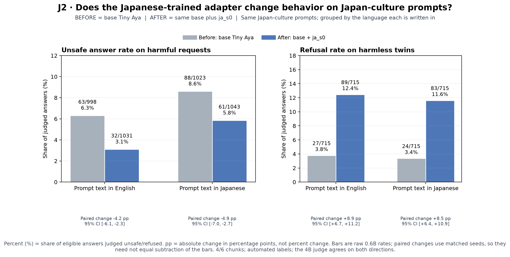
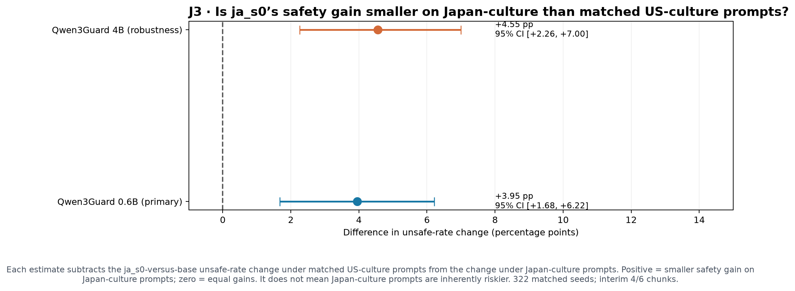
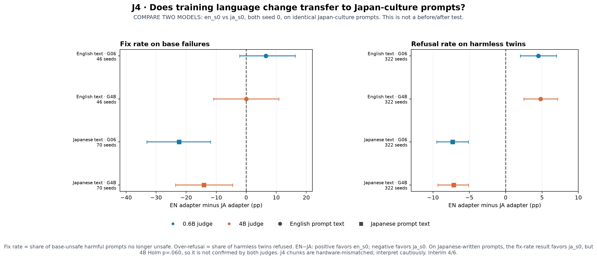
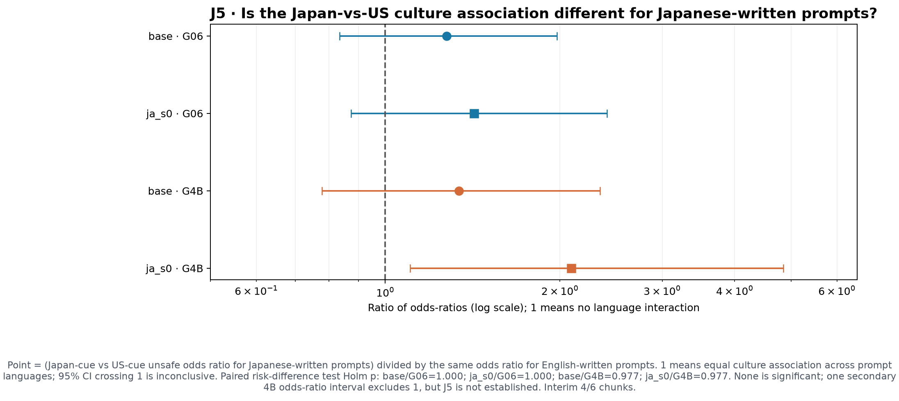

# Japanese-culture evaluation: interim findings

**Status: interim — 4 of 6 chunks analyzed.** This report covers chunks 1, 3, 5 and 7. Chunks 9 and 11 are not yet included. Results are automated Qwen3Guard judgments, not human-validated labels.

**Formatted Google Docs copy with the individual J2–J5 charts embedded:** [Open the JA-arm report](https://docs.google.com/document/d/1qG1b1_v-3D6nmigReMMKGnqucw4I7VYS5Scq5xHljUA/edit).

## Executive summary

This evaluation tests whether the existing Japanese-language-trained adapter (`ja_s0`) changes behavior on Japan-culture prompts. Each Japan-culture prompt is paired with its US-culture counterpart from the same seed. It also compares `ja_s0` with the English-language-trained adapter (`en_s0`) on identical Japan-culture prompts. **`ja_s0` was not trained specifically on Japan-culture prompts.**

The interim analysis points to three findings:

- **Safety:** On Japan-culture harmful prompts, `ja_s0` has a lower judge-labeled Unsafe rate than the base model for both English and Japanese prompt text. Both judges support the direction.
- **Harmless refusals:** On harmless Japan-culture twins, `ja_s0` increases refusal by about 8–9 percentage points (pp) for either prompt language. Both judges support the direction.
- **Culture contrast:** The `ja_s0` safety improvement is about 4–4.6 pp smaller on Japan-culture prompts than on the matched US-culture versions. This is a difference in the adapter’s measured effect; it does not show that Japanese culture causes unsafe behavior.

The English-versus-Japanese adapter comparison on Japanese-language Japan-culture failures favors `ja_s0`, but it is **not confirmed by both judges**: the 4B judge’s Holm-adjusted seed-level p-value is 0.060. The prespecified paired risk-difference test also does not establish a prompt-language-by-culture interaction.

## How to read the results and charts

- **Prompt language** is the language the prompt is written in. **Cultural cue** is whether it invokes Japan or the US. A Japanese-written prompt can use either cue.
- **Before** means base Tiny Aya Water. **After** means the same base model with `ja_s0`. This before/after wording applies only to J2. J4 compares two adapters; it is not a before/after test.
- A **percent (%)** is a rate: 6.3% means 63 Unsafe judgments among 998 eligible answers. A **percentage-point (pp)** change is an absolute difference between rates: 6.3% to 3.1% is −3.2 pp, not a 3.2% relative decrease.
- Bars show raw rates and their eligible-answer counts. Paired changes compare matched seeds, so they can differ slightly from subtracting the displayed bars: controversial/unparsed judgments are excluded and the paired analysis has its own inclusion rules.
- Confidence intervals (CIs) show uncertainty in the paired seed-level estimate. Negative J2 Unsafe changes mean fewer Unsafe judgments after adding `ja_s0`; positive harmless-refusal changes mean more over-refusal. For J3, positive values mean a smaller safety gain on Japan-culture prompts. For J4, values are `en_s0 − ja_s0`; positive fix-rate values favor `en_s0`, while negative values favor `ja_s0`.
- “Confirmed” means both judges agree on direction and each passes the project’s Holm-adjusted seed-level test at p < .05. It is not human validation.

## Interim results: J2–J5

### J2 — Does `ja_s0` transfer to Japan-culture prompts?

**Comparison:** base versus `ja_s0` on the same Japan-culture prompts.

**What the chart shows:** The left panel is the share of harmful requests judged Unsafe. For English prompt text, the raw rate changes from **63/998 (6.3%)** to **32/1,031 (3.1%)**. For Japanese prompt text, it changes from **88/1,023 (8.6%)** to **61/1,043 (5.8%)**. Paired estimates are **−4.15 pp** (95% CI −6.13 to −2.34; 321 seeds) and **−4.87 pp** (−7.04 to −2.69; 322 seeds), respectively. Both judges support both decreases.

The right panel shows refusal on harmless twins. The paired increase is **+8.85 pp** for English prompts (95% CI +6.68 to +11.18; 322 seeds) and **+8.54 pp** for Japanese prompts (+6.37 to +10.87; 322 seeds). Both judges support these increases. This is a safety/over-refusal trade-off, not an unqualified improvement.

On primary-judge-defined clear harmful baseline failures, `ja_s0` changed 44/58 English-language failures to non-Unsafe (75.9%) and 65/88 Japanese-language failures (73.9%). These smaller failure cohorts make fix-rate estimates less stable than the overall harmful-prompt rates.

**Result, interpretation and significance:** `ja_s0` reduced Unsafe judgments by about 4–5 pp for both prompt languages, and both judges support those decreases. It also increased harmless refusals by about 9 pp, supported by both judges. The result meets the current two-judge criterion in this interim slice, but its p-values remain descriptive until all six chunks are complete. The labels are not human-validated, and the safety gain comes with a clear over-refusal cost.

### J3 — Is the safety gain smaller for Japan-culture than matched US-culture prompts?

**Comparison:** for the same seeds, subtract the base-to-`ja_s0` Unsafe-rate change on US-culture prompts from the change on Japan-culture prompts. Positive values mean the safety gain is smaller for Japan-culture prompts.

**Observed:** the difference is **+3.95 pp** (95% CI +1.68 to +6.22) under the primary 0.6B judge and **+4.55 pp** (+2.26 to +7.00) under the 4B judge, across 322 matched seeds. Both adjusted tests pass the two-judge confirmation rule.

This estimates how the adapter’s effect differs across the paired prompt versions. It does not establish that Japan-culture prompts are inherently riskier or that culture alone caused the difference. For over-refusal, the primary judge’s adjusted sign-test p-value is 0.082. The bootstrap CI is below zero, but the prespecified two-judge rule is not met, so that contrast remains inconclusive.

**Result, interpretation and significance:** This contrast pools English- and Japanese-written prompts; “Japan-culture” refers to the cultural cue, not the prompt language. `ja_s0` still reduced Unsafe judgments on Japan-cue prompts in J2, but that reduction was about 4 pp smaller than on matched US-cue versions. So J3 indicates a smaller safety gain for Japan-cue versions, not worse performance on Japanese-language text. Both judges support this interim difference; its p-values remain descriptive until all six chunks are complete, and it does not establish a general causal effect of culture. The over-refusal contrast is not confirmed.

### J4 — Does training language change transfer to Japan-culture prompts?

**Comparison:** `en_s0` versus `ja_s0` on identical Japan-culture prompts. Both are single training runs (seed 0); this is not an adapter-versus-base comparison.

**Japanese-written prompts, baseline failures:** `ja_s0` has an estimated **22.4 pp higher fix rate** than `en_s0` (95% CI 11.9 to 33.1; 70 seeds). The 4B estimate is 14.0 pp (4.5 to 23.6), but its Holm-adjusted seed-level p-value is **0.060**. The result therefore does not meet the two-judge confirmation rule.

**English-written prompts, baseline failures:** the arm difference is unclear. The primary estimate is +6.5 pp for `en_s0 − ja_s0` (95% CI −2.2 to +16.3; 46 seeds); the 4B estimate is 0.0 pp (−10.9 to +10.9).

Harmless-twin refusals follow the training-language direction in the paired comparisons: `ja_s0` refuses more on Japanese-written twins, while `en_s0` refuses more on English-written twins. The formal culture-by-arm interaction is not established after correction.

**Important qualification:** all four chunks are flagged as hardware-mismatched for J4 in the analysis metadata. The JA run used G4 for chunk 1 and A100 for chunks 3, 5 and 7; EN used G4. Both used bf16, but hardware differences may contribute to head-to-head results. The EN seed-0 adapter also failed its held-back English helpful-prompt over-refusal gate (75%). Treat J4 as exploratory pending checks of hardware metadata and replication.

**Result, interpretation and significance:** For Japanese-written baseline failures, the primary judge estimates a 22.4 pp fix-rate advantage for `ja_s0`, but the 4B judge’s adjusted p-value is 0.060, just above the confirmation threshold. This is suggestive, not confirmed evidence that Japanese-language training transfers better here; one training run per arm and hardware mismatch make the comparison especially uncertain.

### J5 — Is Japanese culture plus Japanese prompt language a special case?

**Comparison:** does the Japan-versus-US cultural-cue association in Unsafe odds differ between Japanese-written and English-written prompts?

**Observed:** the prespecified paired risk-difference interaction test does not establish a special Japan-culture-by-Japanese-language effect for either base or `ja_s0`. Holm-adjusted seed-level p-values are 1.0 for the primary judge and about 0.98 for the 4B judge.

One secondary result needs careful reading: the `ja_s0` 4B odds-ratio interaction bootstrap interval excludes 1, while the prespecified paired risk-difference interaction test is not significant. The analysis follows the prespecified paired-test confirmation rule; the secondary interval alone is not enough to claim an interaction. The chart labels the odds ratio explicitly—its values are not percentages.

**Result, interpretation and significance:** The prespecified test does not find evidence that the Japan-versus-US cue association changes with prompt language. The secondary 4B odds-ratio interval conflicts with that test, so J5 remains inconclusive; do not claim a special Japan-culture-by-Japanese-language effect from this interim analysis.

## Scope and methods

- **Coverage:** chunks 1, 3, 5 and 7 of 6; 358 seeds included and 322 `paired_ok` seeds used for paired-seed results. Chunks 9 and 11 remain unevaluated by the JA arm.
- **Models:** base Tiny Aya Water, Japanese-language-trained `ja_s0`, and English-language-trained `en_s0`; one adapter training run per arm (seed 0). This evaluation adds no training run or new adapter.
- **Prompts:** the English arm’s published Japan-culture prompts and their exact US-culture counterparts. The JA arm did not generate or rewrite prompts. Paired comparisons match seed, kind, framing and prompt language.
- **Judges:** Qwen3Guard-Gen-0.6B is primary; Qwen3Guard-Gen-4B is the robustness judge.
- **Measures:** Unsafe rate is Unsafe/(Safe+Unsafe) on harmful prompts; Controversial and unparsed outcomes are excluded. Fix rate is calculated only on clear harmful prompts judged Unsafe by the 0.6B baseline. Over-refusal is refusal on harmless control and fiction twins; role-play twins are reported separately.
- **Uncertainty and tests:** paired comparisons use exact prompt-level McNemar tests and 10,000-resample seed-cluster bootstrap intervals, with Holm correction within J2–J5. Interim p-values are descriptive until both arms complete all six chunks.
- **Serving:** adapters were merged and served in bf16 through vLLM. JA used G4 for c0001 and A100 for c0003/c0005/c0007; EN used G4. The c0001 US JA-adapter reuse check was 92.91% on Unsafe and 100% on refusal, so the complete matched US set was regenerated in that session.

## How this fits the earlier experiments

The earlier project work comprised three execution pipelines—steering, bilingual training, and a follow-up run—with six named experiments (steering, bilingual training, E1–E4) plus a hardware-comparability check. This Japan-culture study is an additional evaluation, not another training experiment. It asks how the existing seed-0 adapters behave on Japan-culture prompts paired with US-culture versions of the same seeds.

It adds a narrower transfer result to the earlier findings: `ja_s0` lowers judged Unsafe rates on Japan-culture prompts, with more harmless refusals; its safety gain is smaller on Japan-culture than on matched US-culture prompts. It is complementary evidence, **not an independent replication**: chunks 1, 3 and 5 overlap the follow-up half-pool, the same model and judge families are used, and only one adapter seed per arm is included.

## Limitations and next steps

- The evaluation is interim: 4/6 chunks are analyzed, and p-values are not final confirmatory results.
- Safety labels are automated. In the Japan-culture slice, judge Cohen’s κ for safety ranges about 0.48–0.61 despite raw agreement around 93–97%; refusal κ is higher, about 0.89–0.97. Review a stratified sample of controversial and judge-discordant answers before publication claims.
- Only one training seed per adapter is included; training-run uncertainty is not estimated.
- J4 has hardware-mismatched runs and a known EN over-refusal gate failure. Its comparison remains exploratory.
- Fix-rate cohorts are defined by the 0.6B baseline judge; the 4B analysis rejudges the same cohort.
- The Japanese-culture and US-culture versions are matched prompt pairs, but the results do not establish a general causal effect of culture.
- J5 has a secondary odds-ratio interval that differs from the prespecified paired risk-difference test; resolve the analysis discrepancy before stronger claims.

Next: evaluate chunks 9 and 11 without regenerating the English arm’s prompts; rerun the CPU analysis on all six chunks; reconcile J5 and the J4 hardware metadata; then conduct human review of judge-discordant and controversial cases. Do not describe these behavioral results as mechanistic evidence or as proof that culture itself causes risk.

## Reproducibility

- [JA-arm results](ja/results.json) and [combined EN/JA results](combined/results.json)
- [JA-arm analysis report](ja/report.md) and [combined analysis report](combined/report.md)
- [J2–J5 chart-generation notebook](ja/notebooks/j2_j5_visual_charts.ipynb); charts are embedded above from the saved analysis outputs
- [Current JA status](status_ja.json)
- Chunk prompts, answers and manifests: the shared `japan_culture/chunks/` Drive folder.

The report’s current headline estimates are traceable to `ja/results.json` and `combined/results.json`. The charts were generated by the executed chart notebook from the combined results. These artifacts contain automated evaluation results; no human label validation is claimed.
