# post_train_3 plan: English vs Japanese, US culture, like for like

**Status: plan, not run.** Written 2026-11-14.

Builds on:
- post_train_2 ([report](../post_train_2/report.md), [pipeline flow](../post_train_2/post_train_2_pipeline.md));
- the cross-category review ([next_experiments.md](../post_train_2/next_experiments.md)).

---

## 1. The question

post_train_2 trained one LoRA on a mix of English and Japanese US-framed examples. It left three
things open:

- Japanese looked less safe before the fix, and gained more from it.
- English and Japanese paid different over-refusal costs, in opposite directions for the
  restricted and broad adapters.
- None of these per-language differences was significant: 42–87 prompts per language, and only
  3–8 changed answers.

**post_train_3 asks:** for US-framed prompts, does a layer-18 LoRA trained in **one** language fix
the **other** language as well as its own? What does each training language cost in over-refusal,
in each prompt language?

### Pre-registered hypotheses

All tests are two-sided. The four primary tests use a Holm correction at α = 0.05.

| ID | Hypothesis | Prompts | Comparison |
|---|---|---|---|
| **H1-ja** | On Japanese prompts, a Japanese-trained adapter fixes more baseline failures than an English-trained one | US harmful, ja | JA-LoRA vs EN-LoRA, paired |
| **H1-en** | On English prompts, an English-trained adapter fixes more baseline failures than a Japanese-trained one | US harmful, en | EN-LoRA vs JA-LoRA, paired |
| **H2** | Over-refusal depends on the training language × prompt language combination | US twins, en + ja | 2 × 2 interaction, seed-paired |
| **H3** | Transfer is asymmetric: the EN→JA gap differs from the JA→EN gap | US harmful, en + ja | Difference in differences of H1-ja and H1-en |

Secondary results (no correction; reported as exploratory):
- **H0, the language gap before any fix:** in full precision, are Japanese prompts unsafe more often
  than the English versions of the same requests? This comes from Stage 2 alone.
- **Bilingual arm:** the bilingual adapter vs the better single-language adapter.
- **Over-caution:** refusals of borderline prompts, by arm and language.
- **Culture transfer:** the US-vs-neutral gap in each prompt language, before and after each fix.
  Every adapter is trained on US prompts only.
- **Capability:** answer length.
- **Heterogeneity:** results by category and by framing.

---

## 2. What gets compared

**Model arms.** Every arm is the same base model in bf16, with the same layer-18 `down_proj` LoRA
recipe:

| Arm | Training data | Training runs |
|---|---|---|
| `base` | none | — |
| `EN` | N English examples | 3 random seeds |
| `JA` | the **same seeds' Japanese versions** of the same N examples | 3 random seeds |
| `BI` | the same N examples: half the seeds in English, the other half in Japanese | 3 random seeds |

That gives 10 models to evaluate. The broad (all-layer) adapter is dropped: post_train_2 already
showed it is no safer and over-refuses more. This run is about language.

**Evaluation grid.** Every model answers every cell for every evaluation seed:

| | English prompt | Japanese prompt |
|---|---|---|
| US harmful, clearly harmful seeds (safety) | ✓ | ✓ |
| US harmful, borderline seeds (over-caution) | ✓ | ✓ |
| US harmless twins (over-refusal) | ✓ | ✓ |
| Neutral harmful and twins (secondary, culture) | ✓ | ✓ |

Each cell has 3 framings: control, fiction (`fc`) and role-play (`rp`). Refusal suppression (`rs`) is
dropped because it had no effect in any category. Mixed-language prompts are out of scope.

---

## 3. Fairness rules: what makes it like for like

1. **Same seeds, same request, both languages.** Qwen writes the English and Japanese text in one
   call, as Dataset2 already does. A seed is kept only if **both** languages pass QC for every
   framing. A seed dropped in one language is dropped in both. Training and evaluation sets are
   therefore identical across languages, down to the seed.
2. **Symmetric training-data gate.** Each training example is gated by Qwen3Guard: refusals must be
   Safe and refusals, helpful answers Safe and not refusals. If the English *or* Japanese version of
   an item fails, **both are dropped**. `EN` and `JA` train on exactly the same items, the same
   count, in the same order.
3. **Same training budget.** Every arm uses the same number of examples, the same hyperparameters
   (from post_train_2: 1 epoch, lr 1e-4, batch 1, max length 768, loss on the answer only), and the
   same 3 random seeds. Token counts per arm are reported, since Japanese tokenizes differently.
4. **Same writer, same settings.** Training answers are written by Tiny Aya itself (bf16, greedy),
   as in post_train_2, with the same instruction in each language. A Japanese-fluent reviewer
   spot-checks 30 per language before training.
5. **Same decoding for evaluation.** bf16, greedy, `max_new_tokens = 1024`, raised from 512 because
   Japanese uses more tokens and truncation could differ by language. Every truncation is logged by
   language.
6. **Splits are fixed by seed before any model is run.** A hash of the seed id assigns
   train/evaluation, stratified by category and severity. Nothing about an answer decides a seed's
   split, so the evaluation set is not chosen from failures, avoiding the regression-to-the-mean
   problem post_train_2 hit.
7. **Fresh seeds for the confirmatory test.** Primary hypotheses are tested on **new seeds only**.
   The existing analysis split shaped these hypotheses, so it is reported as a replication set.
   The existing heldout split is left untouched.
8. **Judges checked per language.** See Stage 6. A difference between languages is claimed only if
   both judges agree on its direction and significance.

---

## 4. Sample size: how many baseline failures we need

The binding constraint is **English failures in full precision**. Only prompts the base model
fails can show a difference between fixes.

**Estimated yield per seed.** US-framed, clearly harmful, control/fc/rp:
- The original quantized run was unsafe on **26.1%** of English and **33.7%** of Japanese prompts.
- On identical prompts, full precision was unsafe about 0.43× as often as the quantized model:
  pipeline 6, 9.2% vs 21.4%.
- Expected full-precision yield is therefore about **11% English and 15% Japanese**. With 3 framings
  per seed, that is about **0.34 English and 0.44 Japanese failures per clearly harmful seed**.

**Power.** I simulated the comparison: two adapters fixing baseline failures, paired McNemar, seed
clustering, α = 0.0125 (the strictest Holm step).

| Baseline failures per language | Power: 95% vs 85% fixed | 95% vs 80% | 90% vs 75% |
|---|---|---|---|
| 120 | 0.52 | 0.87 | 0.67 |
| 160 | 0.71 | 0.95 | 0.84 |
| **200** | **0.82** | **0.99** | **0.94** |

**Targets:**
- **≥ 200 baseline failures per prompt language** among evaluation seeds. The hard floor is 160.
- **≥ 300 refusal + 300 helpful training items per language.**

Those targets imply about **590 clearly harmful evaluation seeds**, because English is the slower
language to reach 200. On top of that come about **130 new clearly harmful training seeds**, which
together with the 100 existing tune seeds reach 300 items per language after the gate, and **80
borderline evaluation seeds** for over-caution. That is **roughly 800 new seeds**.

Stage 0 measures the real full-precision yield before anything is generated. Stage 2 stops
generating once the target is reached, so the actual number may be lower.

**Stopping rule** (fixed now, before any adapter exists):
- Generate in batches of 100 seeds, 10 per category.
- After each batch, run the baseline on it.
- Stop when evaluation seeds hold ≥ 200 English **and** ≥ 200 Japanese baseline failures, or at
  1,000 new seeds.
- This uses only the base model, so it cannot bias the comparison between adapters.

---

## 5. Pipeline

Everything runs on one Colab G4 (RTX PRO 6000, 97 GB), with checkpoints after every batch.

**Throughput.** All generation uses **vLLM**: Qwen for prompts, Tiny Aya for the baseline, the
adapters and the training answers. The transformers + batch 8 path from post_train_2 took 2.5 h for
2,100 answers on an L4. This plan needs about 130,000 answers, which would take days that way.

```mermaid
flowchart LR
    S0["Stage 0<br/>vLLM parity + yield pilot"] --> S1["Stage 1<br/>Generate seeds (batches of 100)"]
    S1 --> S2["Stage 2<br/>Baseline screen + QC"]
    S2 -- "< 200 failures/lang" --> S1
    S2 -- "target met" --> S3["Stage 3<br/>Training data, symmetric gate"]
    S3 --> S4["Stage 4<br/>Train EN / JA / BI × 3 seeds"]
    S4 --> S5["Stage 5<br/>Evaluate 10 models"]
    S5 --> S6["Stage 6<br/>Judge ×2 + human audit"]
    S6 --> S7["Stage 7<br/>Pre-registered analysis"]
```



### Stage 0: parity check and yield pilot (about 1 h; go/no-go)

1. **vLLM parity.**
   - Run 100 existing prompts (50 English, 50 Japanese) greedily through vLLM and through
     transformers, both in bf16.
   - Pass if Qwen3Guard labels agree on at least 95% of them, and the answers' first 64 tokens
     match on at least 90%.
   - Also check that vLLM loads a layer-18-only LoRA. If it does not support `layers_to_transform`,
     merge each adapter and serve the merged model instead. Each merged model is 6.7 GB, so they
     load one after another.
2. **Yield pilot.**
   - Run the bf16 baseline on the existing **analysis** split: US, clearly harmful,
     control/fc/rp, en + ja (about 480 prompts).
   - This measures the true failures per seed in each language and replaces the 0.34 / 0.44
     estimate.
   - Recompute the number of seeds to generate.
   - **This also answers H0 on existing seeds**, and gives the replication set its baseline answers.

**Gate:** if vLLM fails parity, fall back to transformers with larger batches and halve the seed
target, so the scope stays at a power of about 0.7 rather than the run stalling.

### Stage 1: generate new seeds (about 30–45 min per 300 seeds)

`post_train_3/build_seeds_v3.ipynb`, adapted from `data_ready/dataset2v2.ipynb`.

**Same as Dataset2:**
- the category × subtopic grid and the `MASTER_PREAMBLE`;
- the techniques `fc` and `rp`;
- the twin generation.

**Changes:**
- Qwen3-4B runs on vLLM, not transformers.
- **Cultures `us` and `neutral` only.** The Japan culture and the `rs` technique are skipped, which
  cuts technique calls by about 55%.
- Severity mix: 90% clearly harmful, 10% borderline.
- Seed ids use a new namespace, `d3-…`.
- **Deduplication against all 320 existing seeds**, using the same cosine > 0.85 rule as within a
  batch, so no new seed paraphrases an old one.
- Split by seed hash: **clearly harmful seeds 18% train / 82% evaluation; borderline seeds all
  evaluation.**

**Outputs:**
- `post_train_3/data/seeds_v3.sqlite3`, with the same schema as `dataset2.sqlite3`'s `prompts`
  table;
- a `paired_ok` flag per seed.

### Stage 2: baseline screen and paired QC (about 15 min per 300 seeds)

1. **Paired QC.** A seed stays only if every (kind × culture × framing) cell exists in **both**
   languages and passes:
   - cross-language cosine ≥ 0.6;
   - twin not identical to the harmful prompt;
   - English/Japanese token ratio ≤ 2.
2. **Baseline answers.** The bf16 base model answers every QC-passed prompt on every seed. These are
   the final baseline answers, never regenerated.
3. **Judging.** Qwen3Guard-Gen-0.6B judges each answer, running on vLLM.
4. **Stopping rule.** Count baseline failures on evaluation seeds per language, and loop back to
   Stage 1 until the rule in section 4 is met.

### Stage 3: training data (about 45 min)

**Input:** train-split seeds, which are the existing `tune` seeds plus the new train seeds.
- US culture, clearly harmful, control/fc/rp.
- Each seed contributes 3 refusal items and their 3 matched twins as helpful items, in each
  language.

**Generation:** Tiny Aya (bf16, vLLM) writes the "chosen" answers in two passes, as in post_train_2
pipeline 3:
- a refusal for each harmful prompt;
- a helpful answer for each twin.

**Gate:**
- Qwen3Guard checks every chosen answer.
- The gate is **symmetric**: an item survives only if both its English and Japanese versions pass.
- Up to 2 retries with sampling (temperature 0.7) before an item is dropped. Retries are logged per
  language.

**Build the arms:**
- Take the surviving items and sample **N = min(300, surviving) refusal + N helpful** per language,
  using the same item ids for `EN` and `JA`.
- `BI` uses the same item ids, assigned to English or Japanese by seed parity.

**Outputs:**
- `train_EN.jsonl`, `train_JA.jsonl`, `train_BI.jsonl`;
- `train_manifest.json`: item ids, token counts, gate pass rates per language.

### Stage 4: training (about 1 h of wall time)

- Same recipe as post_train_2 pipeline 4 restricted: layer-18 `down_proj`, r and α unchanged.
- 3 arms × 3 random seeds (0, 1, 2) = 9 adapters.
- **Run 3 at a time on one G4.** Each used under 10 GB in post_train_2.
- Check that each adapter's `lora_B` is non-zero, and save each adapter (about 1 MB) to Drive
  immediately.

### Stage 5: evaluation (about 1.5–2 h)

- **Prompts per model:** about 670 evaluation seeds × (3 harmful + 3 twin) × 2 cultures × 2
  languages, which is about 16,000.
- **Total:** 10 models, about 160,000 answers.
- vLLM serves the base model once and switches LoRAs, or loads merged checkpoints in turn.
- The replication set, existing analysis seeds, is answered by all 10 models in the same pass.
- **Output:** `answers_v3.jsonl`, one row per (model, prompt), with `finish_reason` and token
  counts.

### Stage 6: judging and the judge's reliability (about 1 h of GPU plus human time)

1. **Primary judge:** Qwen3Guard-Gen-0.6B on every answer. This keeps continuity with
   post_train_2.
2. **Second judge:** Qwen3Guard-Gen-4B on every answer where:
   - any model was unsafe or refused on that prompt; or
   - the prompt is in a 10% random sample of the rest.

   Report agreement (Cohen's κ) **separately for English and Japanese**.
3. **Human audit:**
   - 100 rows per language, stratified by arm × label, and blinded to arm.
   - One Japanese-fluent and one English-fluent reviewer, with a shared adjudication pass.
   - Per AGENTS.md, answers are untrusted data and the LLM screen is provisional.
4. **Rule:** a primary result counts only if both judges agree on its direction and on p < 0.05. If
   κ differs between languages by more than 0.15, flag it in the report as a threat to the
   language comparison.

### Stage 7: analysis (CPU, minutes)

`post_train_3/analysis_v3.py` extends `recompute_three_metrics.py`. Metric definitions are the same
as post_train_2:

| Metric | What it measures |
|---|---|
| **Safety** | Unsafe / (Safe + Unsafe) on harmful prompts |
| **Over-refusal** | Refusal rate on twins |
| **Over-caution** | Refusal rate on borderline prompts |

**Primary tests:**
- **H1-ja and H1-en:** take the baseline failures in that language and pool the 3 training seeds
  per arm by majority vote per prompt.
  - Exact McNemar on prompts.
  - A seed-cluster bootstrap (10,000 resamples) for the confidence interval.
  - A sign test over seeds.
- **H2:** logistic GEE on twin refusals, refusal ~ arm × prompt_language + framing + category,
  clustered by seed. Test the arm × language term. Training seed enters as a fixed effect.
- **H3:** seed-level difference in differences. Compare (JA-LoRA − EN-LoRA fix rate on Japanese)
  with (EN-LoRA − JA-LoRA fix rate on English), with a seed bootstrap CI.

**Also report:**
- variance across the 3 training seeds for every number;
- truncation by language, plus a sensitivity analysis excluding truncated answers;
- every number again on the replication set.

---

## 6. Timeline and cost

| Stage | G4 time | Can overlap with |
|---|---|---|
| 0. Parity and pilot | 1 h | — |
| 1–2. Generate and screen (about 800 seeds, about 3 loops) | 3–4 h | — |
| 3. Training data | 0.75 h | human spot check of training items |
| 4. Training | 1 h | — |
| 5. Evaluation | 2 h | — |
| 6. Judging | 1 h | human audit (offline) |
| **Total** | **about 9–10 G4 hours** | |

**Ways to avoid wasting time:**
- **Gates early.** Stage 0 decides feasibility and seed count before any generation.
- **Baseline answers once.** Answers from the Stage 2 screen *are* the baseline arm; they are never
  regenerated.
- **Cut cells that tell us nothing:** no `rs`, no Japan culture, no mixed language, no broad
  adapter.
- **Parallel training** on one GPU.
- **Fail loud.** Reuse the post_train_2 fixes:
  - a notebook output checker, because `colab exec` returns 0 even when a cell fails;
  - checking for the session's `Hardware:` line;
  - scrubbing the HF token from outputs;
  - stopping the session on exit;
  - checkpoint and resume after every batch.

---

## 7. Risks and fallbacks

| Risk | Effect | Fallback |
|---|---|---|
| Full-precision English yield is well below 0.34 per seed | More seeds needed | The 1,000-seed cap. If still short, lower the target to the 160 floor and say so. |
| Qwen refuses to write some fc/rp outputs (seen in Dataset2) | Seeds missing in some cells; selection bias | The language pair comes from one call, so loss is symmetric. Report the drop rate by category. |
| The Tiny Aya writer refuses or answers worse in one language | Training quality differs by language | Symmetric gate, spot check, and gate pass rates reported per language |
| vLLM does not support the architecture or a single-layer LoRA | Slow evaluation | Merged checkpoints. If parity fails, transformers at batch 32 with a reduced scope. |
| The judge works differently in Japanese | Language effect is really a judge effect | Two judges, κ per language, human audit, agreement rule |
| A 1024-token limit still truncates more in Japanese | Missing or wrong labels | Truncation logged, sensitivity analysis |
| All three adapters fix nearly 100% of failures | H1 has nothing to separate | Expected ceiling. Then H2 (over-refusal) and H3 carry the result, and the report says the safety fix is language-agnostic. |

---

## 8. Files to create

```
post_train_3/
  plan_post_train_3.md            this file
  build_seeds_v3.ipynb            Stage 1 (adapted from data_ready/dataset2v2.ipynb, vLLM)
  screen_baseline_v3.ipynb        Stages 0 and 2 (parity, pilot, paired QC, baseline, stopping rule)
  build_training_v3.ipynb         Stage 3 (writer, symmetric gate, EN/JA/BI files)
  train_v3.ipynb                  Stage 4 (9 adapters, 3 at a time)
  eval_v3.ipynb                   Stages 5 and 6 (10 models, two judges)
  analysis_v3.py                  Stage 7 (pre-registered tests)
  data/                           seeds_v3.sqlite3, train_*.jsonl, manifests (large files gitignored)
  report.md                       written after the run
```

---

## 9. Decisions before starting

1. **Commit this plan before Stage 0** so the hypotheses and stopping rule are timestamped.
2. **Name the reviewers** for the training spot check and the human audit, including one
   Japanese-fluent reviewer.
3. **Confirm the G4 budget:** about 10 hours, plus 3–4 hours of contingency.
