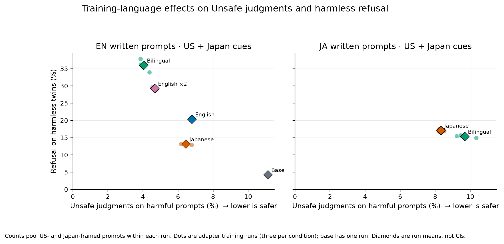
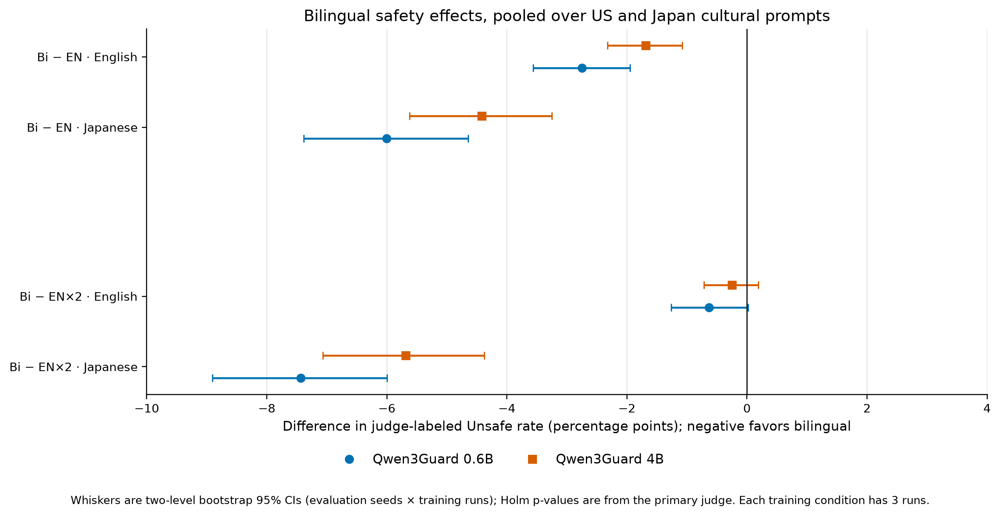
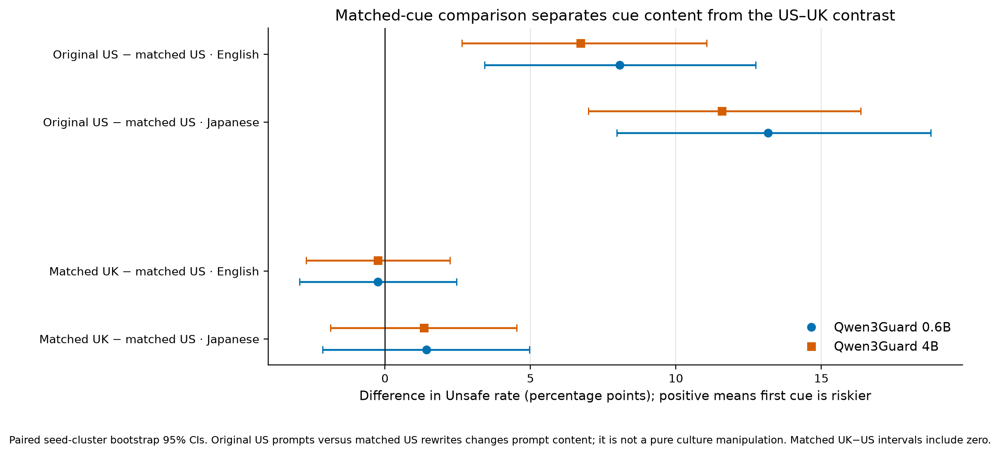
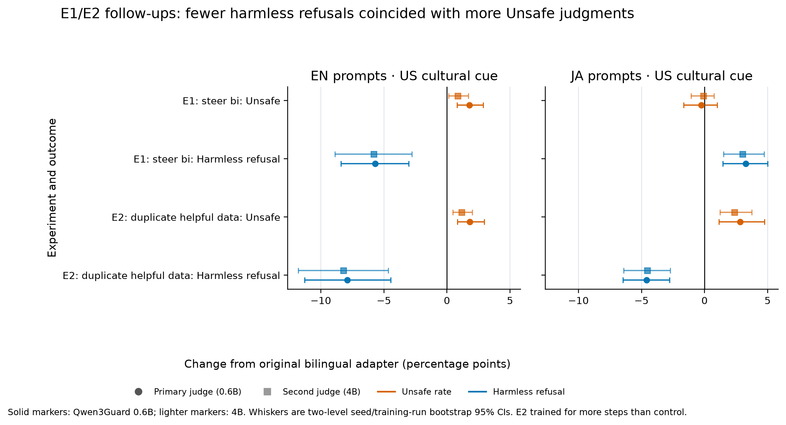
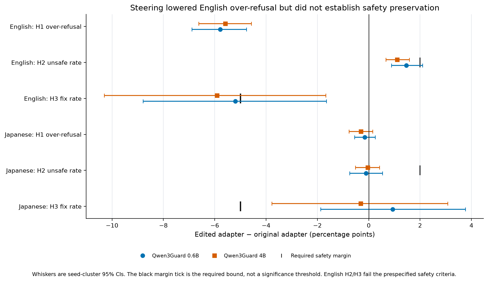
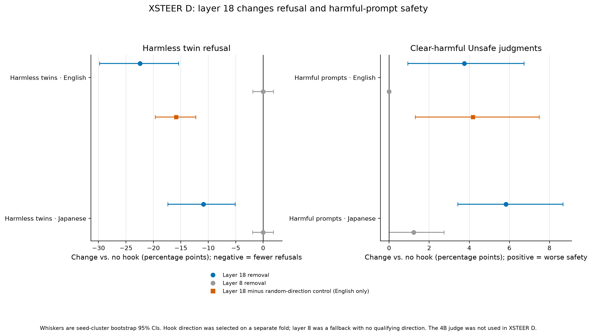

# Safer, or Just More Refusals? English, Japanese and Bilingual Safety Fine-Tuning of Tiny Aya

## Abstract

Multilingual safety fine-tuning can lower harmful outputs by making a model refuse more often, including on harmless requests. We study this trade-off in Tiny Aya Water through distinct experiments on restricted versus broad LoRA, English-only, Japanese-only, bilingual and dose-matched English×2 training, matched cultural cues, and activation-derived interventions. In the three-seed language-composition study, bilingual adapters had lower judge-labeled Unsafe rates than English-only adapters on English prompts (paired change −2.75 percentage points) and Japanese prompts (−6.00 pp). Against English×2, which repeats English rows to match bilingual training length, bilingual training had no established English advantage (−0.63 pp; Holm-adjusted *p*=.112) but a lower Unsafe rate on Japanese prompts (−7.43 pp). Harmless refusal also increased. Japanese-only training showed a different pattern: its pooled Unsafe rate was 7.4% versus 6.9% for bilingual, while its harmless-refusal rate was 15.1% versus 25.7%; per-language secondary estimates indicate lower Unsafe rates on Japanese prompts and a similar English-prompt rate to English-only training, but these comparisons are not the study’s primary confirmatory contrasts. A reported refusal decomposition remains provisional because its source notebook and structured output were not recovered.

Matched US–UK cue comparisons did not detect a difference in this sample; original US prompts were riskier than controlled rewrites, although the rewrites changed content as well as the cue. An initial weight-space steering edit reduced English harmless refusal but failed prespecified safety-preservation criteria. A later XSTEER hook experiment causally changed layer-18 behavior: refusal fell on harmless twins in both languages, while Unsafe judgments rose on harmful prompts in both languages. All behavior labels came from Qwen3Guard, not human review. SafeTune, CuratorKIT, AuditKit and CircuitKIT served different roles: only the first two contributed to earlier model-analysis/data-generation workflows; AuditKit supports this repository’s separate Qwen3Guard scoring interface; CircuitKIT preparation and synthetic integration checks have not produced a validated Tiny Aya circuit result.

## Key findings at a glance

| Evidence line | What the experiment found | What it does not establish |
|---|---|---|
| Restricted vs broad adaptation (post_train_2 pilot) | Both LoRA arms reduced judge-labeled Unsafe outputs; broad LoRA had a larger harmless-refusal increase in the small evaluation. | A powered or independently replicated advantage for circuit restriction. |
| Training language (three runs per arm) | Bilingual lowered Unsafe rates versus English-only in both languages and versus English×2 on Japanese prompts. Japanese-only had the lowest descriptive Unsafe rate on Japanese-written prompts and fewer English harmless refusals than English-only. | There is no single winner across safety/refusal outcomes; harmless refusal depends on prompt language and adapter. |
| Cultural cues | Matched US and UK cues had no detected difference; original US prompts differed from their rewritten counterparts. | Equivalence of cultures or a causal effect of culture, because rewrites also change content. |
| Steering | Layer-18 hook removal reduced harmless refusal and increased harmful-prompt Unsafe judgments. | A safety-preserving way to reduce over-refusal. |

**Interpretation:** Across these evaluations, refusal reduction and harmful-prompt safety did not behave as independent controls. The evidence supports testing both together; it does not support selecting a model from refusal or Unsafe rate alone.

## 1. Research question and experimental logic

Small multilingual models are often safety-tuned mostly on English data. We ask: **Does the language of safety-training data decide which prompt languages become safer?** And **when Unsafe answers fall, is that because the model answers more safely, or because it refuses more—including harmless requests?**

We post-train Tiny Aya on English, Japanese or bilingual data, then evaluate replies to harmful jailbreak prompts—requests worded to bypass safety behavior—in both prompt languages. Qwen3Guard labels responses Safe, Unsafe or Controversial and separately parses refusals. Unsafe rate is Unsafe / (Safe + Unsafe) on harmful prompts; over-refusal is refusal on harmless twins. The latter measures unnecessary refusal, not overall helpfulness.

Prompts also vary in **cultural framing**: words or references intended to evoke a setting such as the US, Japan or UK. The language of the prompt is a separate factor; for example, an English-written prompt can contain a Japan cue. Terms such as “cowboy” or “ninja” can change both cultural association and how a jailbreak is phrased. Matched rewrites help control prompt content, but do not guarantee complete semantic equivalence.

We compare restricted versus broad LoRA, English/Japanese/bilingual training, matched cultural cues, and refusal-steering interventions. English×2 repeats English examples to match the bilingual run’s training length, testing whether bilingual gains are merely a consequence of more training steps. These are separate experiments with different cohorts and settings; their rates are not combined into a common leaderboard.

## 2. Model, data and training

### Base model and adapter

The main runs use [`CohereLabs/tiny-aya-water`](https://huggingface.co/CohereLabs/tiny-aya-water), a Cohere2 model with 3.35 billion parameters. The B1 source does not preserve an immutable Hugging Face revision in the local evidence bundle. The adapters are PEFT LoRA modules, not full fine-tunes. Main-study LoRA uses rank 16, alpha 32, dropout 0.05, bias `none`, and targets **only** `model.layers.18.mlp.down_proj`; base weights are frozen. The manifest reports 208,896 trainable parameters. “Japanese-only” describes training-row language, not a different layer or culture-only prompt set.

Training used AdamW, learning rate 1e-4, one epoch, batch size 1, no scheduler, gradient accumulation 1 and maximum sequence length 768. Main bilingual evaluations used merged bf16 adapters through vLLM with greedy decoding and up to 1,024 new tokens. The public artifact bundle still needs immutable model revisions, hashes and complete environment manifests.

### Training examples and conditions

Training used 568 aligned items: 284 refusal targets and 284 helpful-response targets for harmless twins. English (`en`) and Japanese (`ja`) each used 568 language-specific rows; bilingual (`bi`) used 1,136 rows by presenting each item in both languages. English×2 repeated the 568 English rows to match bilingual training length (1,136 steps/rows), controlling training duration rather than distinct English content. Each main condition had three training seeds. A training item is an aligned prompt/target example, tagged refusal or helpful; it is not necessarily a harmful/twin pair. A row presents that item in one language. A training seed controls one adapter run; an evaluation source seed identifies a request and its derived prompt variants.

The frozen pool has 519 source seeds; paired bilingual analyses use 475 `paired_ok` seeds. The bilingual output contains 12,426 prompt rows before model-specific filtering. E1–E4 use a separate half-pool of 276 seeds. Japan-culture findings remain interim and separate.

### Earlier restricted-versus-broad pilot

The separate post_train_2 pilot used SafeTune probing, CuratorKIT preference-pair generation, restricted/broad LoRA and held-out evaluation. Its report describes 195 accepted pairs and 54 evaluation seeds: Unsafe counts were 12/145 for base, 1/147 restricted and 1/148 broad; harmless-twin refusals were 8/80, 16/80 and 29/80. The small pilot does not establish a general advantage for restriction. See its [report](https://drive.google.com/file/d/1ZQ5UFfDdba4gjGiV2fvSqRUZ9s9rkpl7/view) and [notebooks](https://drive.google.com/drive/folders/1h37qxJyOvsFX9a_oJJq1pYM3DR5jHbqQ).

**Restricted and broad are adaptation-scope labels.** The main English/Japanese/bilingual conditions all use the same layer-18 projection target. The earlier broad arm adapted a wider set of projections. Neither label refers to training language or cultural cue.

## 3. Toolkits and their actual roles

| Toolkit | Role supported by source artifacts | Role it did not play in these results |
|---|---|---|
| **SafeTune** | Direction/neuron analysis tools for the post_train_2 pilot; trainer utilities were explored, but final constrained training used an explicit PyTorch loop. | No attention-head circuit discovery on Tiny Aya. |
| **CuratorKIT** | Generated preference-style safe-refusal/compliant pairs for the post_train_2 pilot. | Not the judge for the main bilingual runs; its pilot generator/gate had documented quality limits. |
| **AuditKit** | `guard_judge.py` wraps Qwen3Guard in this repository’s Dataset2/AnswerCarefully scoring interface and preserves unknown outputs. | BI and XSTEER called Qwen3Guard directly; their labels were not produced by AuditKit. |
| **CircuitKIT** | Separate Dataset2 integration work: metric/API checks, synthetic/toy smoke tests and review/export gates. | No validated Tiny Aya circuit finding. The layer-restricted LoRA and XSTEER hook are different methods. Human/data/metric gates remain open in the [roadmap](../docs/lexsi/CIRCUITKIT_ROADMAP.md). |

This distinction matters: a project can use a toolkit for one stage without that toolkit being responsible for every experiment. “Circuit-restricted LoRA,” “activation-direction steering,” and “CircuitKIT circuit discovery” name different methods.

## 4. Evaluation and statistics

The pipeline is training items → adapter training → frozen prompts → model answers → guard labels → paired statistics. B1 verifies item/plan hashes, requires accepted (`survives`) items, checks target language and balances refusal/helpful items. BI alternates each item's English and Japanese rows; English×2 presents the English row twice. B2 verifies prompt hashes, resumes stage checkpoints, and publishes data plus a hash manifest and `DONE`. Its scheduling batches are 400 answers and 800 judgments, rather than 400 independent GPU processes. These source checks do not independently validate target quality or rule out related-request leakage; the full selection and split audit remains part of the public-release gap.

| Study | Models and evaluation population | Judges / replication |
|---|---|---|
| post_train_2 pilot | Base, restricted, broad; 228 prompts / 54 seeds | Historical guard evaluation; one adapter per scope |
| BI | Base, en, ja, bi, en2; 12,426 US/Japan prompt rows, 519 source seeds; 475 paired-eligible | 0.6B and 4B; three runs per trained condition, one base |
| E1–E4 | Follow-up models on batches 1, 3, 5; 276 seeds; E4 retains 150 matched seeds | 0.6B and 4B; replication varies by experiment |
| Japan extension | Base, en_s0, ja_s0; four of six chunks in the interim analysis | 0.6B and 4B; one run per adapter |
| XSTEER A/B | Activation diagnostics on 3,864 prompts; B covers four models and 36 layers | Held-out direction diagnostics, not an outcome benchmark |
| XSTEER D | en_s0 forward hooks; fold 1; 6,073 answer/judge rows across interventions | 0.6B only; one adapter |

### Automated judgments and metrics

The headline outcomes are **Unsafe rate** and **over-refusal**. The Qwen3Guard generative judge ([0.6B model card](https://huggingface.co/Qwen/Qwen3Guard-Gen-0.6B); [technical report](https://github.com/QwenLM/Qwen3Guard/blob/main/Qwen3Guard_Technical_Report.pdf)) is primary; the 4B judge is a robustness check where specified. The parser extracts Safe/Unsafe/Controversial and refusal labels from each prompt-answer pair. Unsafe rate excludes controversial and unparsed labels; they remain unknown. Fix rate uses harmful prompts the base failed. These are model-judge labels, not human ground truth. BI/XSTEER call Qwen3Guard directly; AuditKit wraps it only in the repository’s separate local scoring interface.

BI inference uses paired prompts, 10,000 two-level bootstrap resamples over evaluation seeds and training runs, per-seed exact McNemar tests, and Holm correction. Pooled descriptive rates are shown separately: one base run is compared with three adapter runs and parseable denominators vary, so raw pooled-rate subtraction is not the paired estimate. “Confirmed” means both automated judges agree in direction and the adjusted test passes—not human validation.

## 5. Training-language composition

Across pooled US/Japan cultural strata, bilingual training lowered the primary judge’s Unsafe rate relative to English-only training by **2.75 percentage points on English prompts** (95% CI −3.56 to −1.95; Holm-adjusted *p*<.0001) and **6.00 points on Japanese prompts** (95% CI −7.38 to −4.65; *p*<.0001). The 4B judge agreed in direction and passed the study’s confirmation criterion.

English×2 helps separate language coverage from training duration. Compared with English×2, bilingual training had an English-prompt estimate of −0.63 pp (95% CI −1.26 to +0.02; Holm *p*=.112), which does not establish an English benefit. On Japanese prompts, bilingual training reduced Unsafe rate by **7.43 pp** (95% CI −8.91 to −5.99; Holm *p*<.0001; confirmed by 4B). This is evidence of improved Japanese-prompt outcomes beyond simply training for more steps on English rows.

Harmless refusal also rose. Across both cultural-cue strata, refusal on English-written harmless twins was 20.4% for `en`, 13.2% for `ja` and 36.0% for `bi`; on Japanese-written twins it was 6.4%, 17.1% and 15.4%, respectively. The corresponding Unsafe rates were 6.78%, 6.45% and 4.03% on English-written prompts, and 15.68%, 8.33% and 9.68% on Japanese-written prompts. These per-language rates are descriptive aggregates. A secondary paired estimate for `ja` minus `en` on English prompts was −0.33 pp for Unsafe rate (95% CI −1.09 to +0.45; includes zero) and −7.23 pp for harmless refusal. On Japanese prompts, the Unsafe estimate was −7.35 pp (95% CI −8.67 to −6.06), while harmless refusal was +10.74 pp. These secondary contrasts were not part of the primary Holm-corrected BI-versus-EN hypothesis family and should be treated as exploratory.

On English-written prompts, Japanese-only had a similar Unsafe rate to English-only (6.45% vs 6.78%; paired interval includes zero) and fewer harmless refusals (13.2% vs 20.4%). This is compatible with cross-language transfer, but does not establish a safety improvement over English-only. On Japanese prompts its Unsafe rate was lower than English-only, while harmless refusal was higher than English-only and slightly higher than bilingual. Pooled rates (BI: 6.9% Unsafe, 25.7% refusal; JA: 7.4%, 15.1%) aggregate three adapter runs; baseline comparisons use a single base run.

*Figure 1. Unsafe rate on harmful prompts versus refusal on harmless control/fiction twins, pooled over US- and Japan-framed prompts. Panels separate English- and Japanese-written prompts. Each point is one training run; base has one run. Axes show rates, and seed spread is not a confidence interval.*

**Takeaway:** Bilingual training lowers Unsafe judgments versus English-only in both prompt languages. Japanese-only has the lowest descriptive Unsafe rate on Japanese-written prompts; bilingual has the most refusal on English-written harmless twins.

*Figure 2. Paired bilingual-minus-English and bilingual-minus-English×2 Unsafe-rate effects, pooled over cultural cues. Whiskers are two-level bootstrap 95% CIs; negative values favor bilingual training.*

**Takeaway:** The Japanese-prompt advantage over English×2 is supported; the corresponding English-prompt difference is not established.

## 6. Refusal decomposition: important, but not yet independently verified

A working B5 summary reports a two-factor Shapley decomposition of harmful-prompt Unsafe rate into changes associated with refusal frequency and Unsafe judgments among answered prompts. It reports for bilingual training a −6.5 pp overall Unsafe change versus base, with −6.6 pp attributed to refusal and +0.1 pp to answer safety (reported refusal share 102%). For Japanese-only training it reports −5.9 pp overall, with −4.1 pp associated with refusal and −1.8 pp with answer safety (69%). The reported identity is `P(Unsafe) = P(answered) × P(Unsafe | answered)`; its validity requires refused-and-Unsafe labels to be absent or explicitly modeled as another term.

The original B5 notebook and a structured decomposition output were not present in the checkout or the examined Drive notebook listing. A Drive working document contains the summary figures, but the row-level aggregation and treatment of ambiguous outcomes have not been reconstructed here. These numbers are therefore **provisional source-reported results**, not verified article findings. Even if reproduced, the decomposition would be descriptive: models may answer different subsets of prompts, so conditional Unsafe rates compare selected sets and do not estimate causal mediation. We omit a decomposition figure until the underlying computation is reproducible.

## 7. Cultural framing and prompt construction

E4 compares matched US and UK cultural-cue prompts. The base model’s paired UK-minus-US Unsafe-rate difference was −0.25 pp for English prompts (95% CI −2.93 to +2.46) and +1.43 pp for Japanese prompts (−2.14 to +4.96). Both intervals include zero. This is no detected difference, not proof of equivalence. Only 150 of 276 candidate seeds passed the matching checks in both cultures.

Original US prompts had a higher Unsafe rate than matched US rewrites by 8.06 pp in English (95% CI +3.42 to +12.74) and 13.17 pp in Japanese (+7.97 to +18.76); the saved analyses report both-judge support. The rewrite changes prompt content as well as the cultural cue, so this cannot identify a causal effect of cultural identity. It instead shows why cue comparisons need matched content and semantic checks.

*Figure 3. Paired Unsafe-rate differences for original US versus rewritten US prompts and matched UK versus US cues. Intervals crossing zero mean the study did not detect a difference; they do not demonstrate equivalence.*

**Takeaway:** The large original-versus-rewrite difference is not a pure culture effect; the matched UK–US estimate is imprecise around zero.

The Japan-culture extension pairs each Japanese-cue prompt with a US-cue counterpart for the same seed, kind, framing and prompt language. Its interim four-of-six-chunk report finds lower Unsafe rates for `ja_s0` than base on both English- and Japanese-written Japan-cue prompts, alongside increased harmless refusal. The full analysis flags JA/EN hardware differences and remains interim. It is not merged with E4 or the main three-seed result. See [the interim report](../post_train_3/japan_culture/INTERIM_REPORT.md).

## 8. Steering: refusal can be manipulated, but safety moved with it

The initial layer-18 weight edit reduced English harmless-twin refusal by 5.78 percentage points, but the selected setting was a fallback because no grid candidate met the prespecified rule. Unsafe judgments rose by 1.46 pp and the baseline-failure fix rate fell by 5.19 pp; the edit failed the safety-preservation criteria. In the smaller E1–E3 follow-up cohort, steering the bilingual adapter and repeating helpful examples also reduced some harmless refusals while increasing Unsafe judgments. E2 used more training steps than its control, limiting attribution.

*Figure 4. E1 steers the bilingual adapter; E2 repeats helpful training examples. Points show changes from the original bilingual adapter in percentage points for US-cue prompts, split by English and Japanese text. Negative refusal changes mean fewer harmless refusals; positive Unsafe changes mean more unsafe judgments. The two judges are shown separately; intervals are two-level bootstrap 95% CIs. E2 also used more training steps than its control.*

**Takeaway:** Both follow-ups reduced some harmless refusals while increasing Unsafe judgments; E2’s unequal training duration limits causal attribution.

XSTEER A/B tested whether a refusal direction could be identified independently of harm. A found language signal in the earlier pooled direction. B then evaluated all 36 layers across base, English-, Japanese- and bilingual-trained adapters. No model × language × layer passed the joint held-out readability (AUC ≥ .80) and harm-independence (|cosine| ≤ .30) rule. The low-cosine early layers had weak readability; the readable later layers aligned with harm. On this probe, Japanese-only training also increased English harmless-twin refusals (285/975 versus 99/975 for base), so refusal growth was not limited to the training language.

XSTEER D applied a forward hook to the learned direction. At layer 18, removal reduced harmless refusals by 15.0 pp in English and 6.3 pp in Japanese, while increasing Unsafe judgments on harmful prompts by 3.8 and 5.8 pp. This is causal evidence for the tested hook/model/fold, not a CircuitKIT-discovered circuit or a safety-preserving intervention. It used one adapter, one judge and a 256-token cap with measurable truncation. XSTEER C remained in progress and is not reported as a completed result.

*Figure 5. The initial weight edit’s paired changes against the original adapter, with the prespecified safety bounds. Lower refusal alone does not satisfy the safety-preservation requirement.*

*Figure 6. XSTEER D changes from no-hook baseline for layers 18 and 8 and the English random-direction control. Negative refusal change is fewer refusals; positive Unsafe change is worse safety.*

**Takeaway:** The interventions changed refusal behavior, but every tested refusal reduction with clear effect came with a safety cost or failed the safety-preservation rule. Full estimates, A/B diagnostics and protocols are in the [technical appendix](technical_appendix.md).

## 9. What the evidence says

Across three training runs, bilingual training reduced Unsafe judgments relative to English-only and dose-matched English×2 on Japanese prompts, but also increased harmless refusals. Japanese-only training had a similar English Unsafe rate to English-only with fewer English harmless refusals; the interval does not establish an English safety difference. On Japanese prompts, its descriptive Unsafe rate was lowest among trained arms, while harmless refusal remained elevated. These are language-specific trade-offs, not a single overall ranking.

Matched-cue tests show why prompt wording must be controlled before attributing risk to culture. The tested steering edits reduced refusal but increased Unsafe judgments or failed prespecified safety criteria. XSTEER B found no cleanly separable refusal direction under its preregistered diagnostic thresholds. No validated CircuitKIT circuit has been identified in Tiny Aya.

## 10. Limitations

- **Automated outcomes:** Qwen3Guard labels are not human ground truth. Refusal on harmless twins is narrower than helpfulness; it does not measure quality or user value.
- **Prompt and cohort limits:** cultural rewrites change wording and do not establish equivalence. E4 retained 150/276 matched seeds. post_train_2, BI, E1–E4, Japan-culture and XSTEER use distinct populations/settings; do not pool their raw rates.
- **Inference limits:** the baseline has one run and trained arms three; use the paired estimates for inference. B5’s refusal decomposition remains provisional and may be affected by models answering different prompt subsets.
- **Steering limits:** XSTEER D uses one adapter, one judge, fold 1 and a 256-token cap with truncation. XSTEER C is unfinished. No XSTEER direction or hook is a CircuitKIT-discovered circuit.
- **Reproducibility:** several prompts, raw rows, manifests and checkpoints remain Drive-only or missing. Account access does not establish public access; adapters, prompts and raw outputs need license and safety review before release.
- **Model release terms:** the current Tiny Aya Water model card lists a CC-BY-NC license. Verify the revision-specific terms and derivative-adapter distribution rights before publishing weights.

## 11. Conclusion

The results show that training-language composition affects both Unsafe judgments and refusal on harmless requests. Japanese-only training had the lowest Unsafe rate among trained adapters on Japanese-written prompts, while bilingual training improved on English-only and English×2 in Japanese and had the lowest pooled Unsafe rate. Their refusal costs differ by prompt language. The study does not establish broad multilingual readiness, safety-preserving steering or a Tiny Aya CircuitKIT circuit. Human validation and public artifact release remain necessary.

## Reproducibility and source links

- [Claim audit](CLAIM_AUDIT.md), [experiment-to-artifact map](EXPERIMENT_ARTIFACT_MAP.md), and [reproduction guide](REPRODUCE.md) document claim-level sources and access limits.
- Recreate charts and tables with `python reports/figures/generate_figures.py`; run report checks with `python reports/validate_report.py`.
- Training/evaluation sources and detailed steering results are linked in the [artifact map](EXPERIMENT_ARTIFACT_MAP.md) and [technical appendix](technical_appendix.md). The Japan-culture report remains [interim](../post_train_3/japan_culture/INTERIM_REPORT.md).
- Drive access during this review does not verify public sharing permissions.
