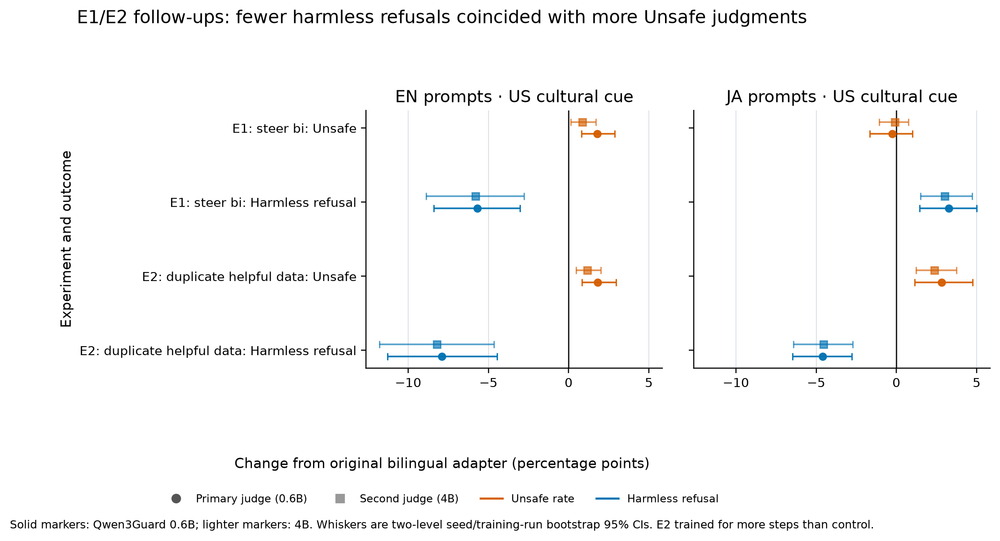
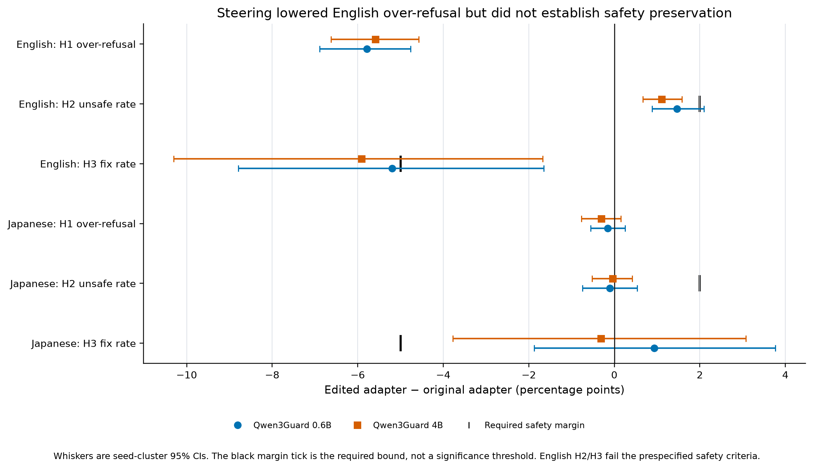
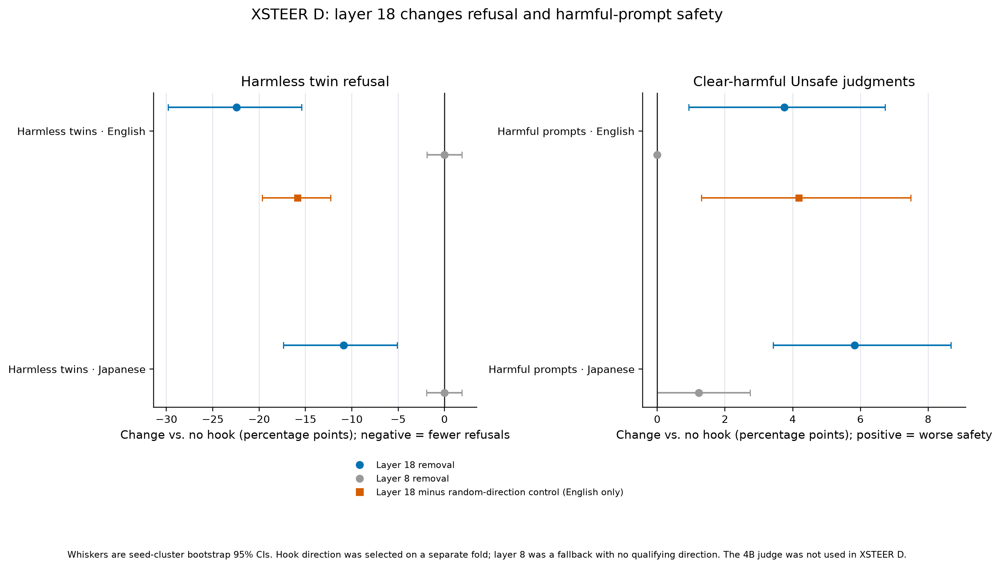

# Technical appendix: steering and mechanistic follow-ups

This appendix preserves the detailed steering protocol, estimates, limitations and source qualifications that support the concise main-text synthesis.

## 8. Steering and mechanistic follow-ups

### Original weight-space steering

The initial steering pipeline estimated a refusal-related direction, orthogonalized it against a harmful-versus-harmless direction, and removed part of it from English adapter `en_s0` at layer 18 with strength 0.5. The final choice was a fallback because no grid candidate met the prespecified admissibility rule. English harmless refusal fell from 20.9% (415/1,988) to 15.1% (300/1,988), a −5.78 pp paired change (95% CI −6.89 to −4.76; Holm *p*=5.43×10⁻²⁷; both judges agreed). English Unsafe judgments rose from 6.6% (189/2,857) to 7.8% (222/2,853), +1.46 pp (95% CI +0.89 to +2.10). The required +2 pp safety margin was not established because the interval reaches beyond it. Baseline-failure fix rate declined from 72.1% (222/308) to 66.9% (206/308), −5.19 pp, failing the −5 pp non-inferiority requirement. The weight edit lowered one unwanted behavior but was not a safety-preserving fix.

### Follow-up training and steering tests

The E1–E3 follow-up cohort used only the first three frozen-pool batches and should not be combined with the full-pool BI analysis. E1 steered the bilingual adapter: English harmless refusal fell 5.68 pp (95% CI −8.39 to −3.02; both judges agreed), while English Unsafe rose 1.77 pp (+0.80 to +2.86; not confirmed by the 4B judge). Japanese-prompt harmless refusal rose 3.26 pp (+1.45 to +5.01; confirmed). As in the original steering run, no candidate met the selection rule and the layer-18/0.5 fallback was used.

E2 repeated helpful training examples. Refusal fell 7.91 pp in English and 4.59 pp in Japanese prompts; Unsafe increased 1.81 and 2.82 pp, respectively, with both judges supporting the directions. This comparison is confounded by training dose: the intervention trained for 1,704 steps versus 1,136 for the control. E3 tested Japanese-only replication and an English×2 dose control. On US-culture Japanese-written prompts, `ja2` had 6.3% Unsafe versus 19.9% for `en2` (paired change −13.59 pp, 95% CI −16.44 to −10.83); on US-culture English prompts `ja2` was worse than `en2` by +3.42 pp (+1.93 to +4.95). The split-half replication used one training run per half, so it is supporting evidence rather than a new three-seed estimate.

*Figure 4. E1 steering and E2 repeated-helpful-data changes on the follow-up cohort. Negative Unsafe change is safer; negative harmless-refusal change is fewer refusals. Whiskers are the saved two-level bootstrap 95% CIs.*

**Takeaway:** Across E1 and E2, lower harmless refusal coincided with higher Unsafe judgments; E2’s unmatched training dose limits attribution to the duplicated examples alone.

*Figure 5. Original versus edited adapter effects. The black marks indicate prespecified safety bounds; reducing refusal does not count as success when the safety-preservation criterion fails.*

**Takeaway:** The initial edit substantially reduced English harmless refusal but did not retain the required safety performance.

### XSTEER A and B: testing whether refusal has a separable direction

XSTEER A revisited the refusal direction on 3,864 prompts, including 1,956 harmless twins, with seed-level folds. The old pooled direction was identical to the earlier steering direction, but for `en_s0` it was strongly aligned with a language direction: cosine 0.60 at layer 18 and 0.87 at layer 8; a language-only classifier reached held-out AUC 0.70 at layer 18. The language-balanced direction was more harm-aligned (cosine with the harm direction 0.78 at layer 18 versus 0.61 for the pooled direction). No evaluated model/language/layer met the prespecified joint bar for held-out refusal discrimination (AUC ≥ .80) and low harm alignment (absolute cosine ≤ .30). Layer 8 was selected only as a fallback and had weak signal. Thus the analysis diagnoses language confounding in the earlier direction and a lack of a cleanly separable over-refusal vector; it does not itself establish an intervention effect.

XSTEER B extended the diagnostic from seven selected layers to **all 36 decoder layers** and from base/`en_s0` to base, `en_s0`, `ja_s0` and `bi_s0`. It used the same 3,864-prompt extraction set (1,099 exact harmful/twin pairs and 971 English/Japanese twin pairs), two seed-hash folds, merged bf16 models and L4 hardware. The pre-set rule required an over-refusal direction to be readable on held-out seeds (AUC ≥ .80) while remaining weakly aligned with the harmful-versus-harmless direction (absolute cosine ≤ .30). **No model × language × layer cell passed both thresholds.** Where the direction had stronger held-out readability—especially layers 16 onward—it was more aligned with harm; low-cosine early layers were weaker at identifying refusal. The selected L1 was a fallback/negative control, not a discovered intervention layer.

The expanded result also weakens a simple claim that over-refusal is confined to the language used for training. On this extraction set, `ja_s0` refused 285/975 English harmless twins, compared with 99/975 for base; it also refused 258/981 Japanese twins, compared with 101/981 for base. Direction estimates for the English and Japanese adapters were similar within language (same-language cross-adapter cosines 0.78–0.97), while estimated harm directions were strongly aligned in middle layers (about 0.93 at layers 16–20). These are representational similarities in this probe, not proof of a single causal circuit. The earlier pooled direction also carried a language signal: its language-only held-out AUC reached 0.75 for `en_s0`, compared with at most 0.57 for base; at L1 its cosine with the pooled language direction was 0.98. This makes language contamination a plausible contributor to why the earlier edit affected English more than Japanese, but it does not establish that as the sole cause.

The B report is complete and cross-checks the saved A results within the stated tolerances. A later XSTEER C run was still in progress when this article was prepared and is **not** included as a completed finding. See the [XSTEER B report](https://drive.google.com/file/d/1Cl04yW5MPBhQUVnykWh0O-ZUNhikkizl/view) and [structured results](https://drive.google.com/file/d/10Om79lHcquHI6V5hocD0NljcgIJllPih/view).

### XSTEER D: causal hook test

XSTEER D used a forward hook on the decoder layer output, at every prompt and generated-token position, to remove or add the direction from A. It evaluated fold-1 prompts with merged `en_s0`, greedy HF generation to 256 tokens, and Qwen3Guard-0.6B. Layer 8 was A’s fallback; layer 18 was the target where the direction had stronger projection. With layer-18 removal, harmless-twin refusal fell **15.0 pp** in English (95% seed-bootstrap CI −18.6 to −11.4; 0 forward refusal flips and 66 refusal-to-answer flips) and **6.3 pp** in Japanese (−9.6 to −3.4). A matched random direction changed English refusal by about +0.9 pp; the layer-18 learned-direction effect relative to that control was −15.9 pp (−19.7 to −12.3).

The same layer-18 removal increased Unsafe judgments on clear harmful prompts by **3.8 pp in English** (95% CI +0.9 to +6.7; exact McNemar *p*=.012) and **5.8 pp in Japanese** (+3.4 to +8.7; *p*=.0001). Harmful refusals fell by 8.4 and 10.0 pp. The random-direction English Unsafe contrast was +4.2 pp; the control result does not remove the safety cost. At layer 8, the interventions had little measurable effect. The results support a causal effect of this hook intervention on the measured outputs in this fold, and show that orthogonalizing against estimated harm directions did not make the intervention safety-neutral. XSTEER D uses one adapter seed, one judge, truncation at 256 tokens and no 4B robustness test.

*Figure 6. XSTEER D change from no-hook baseline for layer 18, layer 8 and, for English contrasts, the matched random-direction control. Whiskers are seed-cluster bootstrap 95% CIs. Negative refusal change is fewer refusals; positive Unsafe change is worse safety.*

**Takeaway:** Layer-18 removal causally reduced harmless refusals in both languages while increasing harmful-prompt Unsafe judgments; this is a trade-off, not a safe debiasing result.

